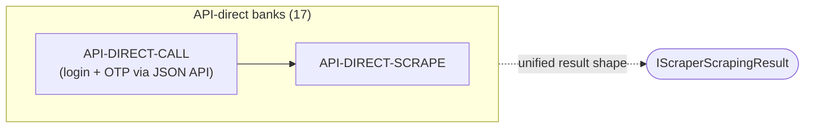

<a id="readme-top"></a>

# Israeli Bank Scrapers

**Scrape transactions from 17 Israeli banks and credit card companies.**
Direct HTTP/TLS bank API calls, automatic OTP handling, and end-to-end PII
redaction — so you can share a failing log without leaking customer data.

```sh
npm install @sergienko4/israeli-bank-scrapers
```

```typescript
import { CompanyTypes, createScraper } from '@sergienko4/israeli-bank-scrapers';

const scraper = createScraper({
  companyId: CompanyTypes.Hapoalim,
  startDate: new Date('2024-01-01'),
  otpCodeRetriever: async phoneHint => await getCodeFromUser(phoneHint),
});

const result = await scraper.scrape({ userCode: '1234567', password: 'secret' });

if (result.success) {
  for (const [index, account] of (result.accounts ?? []).entries()) {
    console.log(
      `Account ${index + 1}: ${account.txns.length} txns, balance ${account.balance ?? 'n/a'}`,
    );
  }
}
```

That is the whole API. Every bank uses the same two calls, and every one returns
the same result shape — what varies is which credential fields you pass, and
whether the OTP callback belongs in the options or the credentials
([details below](#otp-two-factor-authentication)).

[](https://www.npmjs.com/package/@sergienko4/israeli-bank-scrapers)
[](https://www.npmjs.com/package/@sergienko4/israeli-bank-scrapers)
[](https://github.com/sergienko4/israeli-bank-scrapers/actions/workflows/main-pipeline.yml)
[](https://sonarcloud.io/summary/overall?id=sergienko4_israeli-bank-scrapers)
[](https://nodejs.org/)
[](./LICENSE)

> **Documentation** — [User guide](https://sergienko4.github.io/israeli-bank-scrapers/)
> · [API reference](https://sergienko4.github.io/israeli-bank-scrapers/api/)
> · [Changelog](./CHANGELOG.md)
> · [Contributing](./CONTRIBUTING.md)

A maintained fork of [eshaham/israeli-bank-scrapers](https://github.com/eshaham/israeli-bank-scrapers),
rewritten onto a typed phase-based pipeline using TypeScript strict mode.
All supported banks use direct API calls. There is no browser engine,
browser download or browser-specific install script.

<!-- Regenerate the TOC below with:
     npx doctoc README.md --title '## Table of Contents'
     (doctoc strips comments inside its own markers, so this note lives outside them) -->
<!-- START doctoc generated TOC please keep comment here to allow auto update -->
<!-- DON'T EDIT THIS SECTION, INSTEAD RE-RUN doctoc TO UPDATE -->

## Table of Contents

- [Why this fork](#why-this-fork)
- [Requirements](#requirements)
  - [Tested Node versions](#tested-node-versions)
  - [Node 22 is no longer supported](#node-22-is-no-longer-supported)
- [Supported institutions](#supported-institutions)
- [OTP (two-factor authentication)](#otp-two-factor-authentication)
- [What you get back](#what-you-get-back)
  - [The same data, on disk](#the-same-data-on-disk)
- [Your credentials](#your-credentials)
- [Handling failures](#handling-failures)
- [How it works](#how-it-works)
- [Documentation](#documentation)
- [Contributing](#contributing)
- [Contributors](#contributors)
- [Built with this library](#built-with-this-library)
- [License](#license)

<!-- END doctoc generated TOC please keep comment here to allow auto update -->

## Why this fork

- **Browserless banking** — supported institutions authenticate and fetch
  data through their APIs without launching a browser.
- **PII redaction you can trust** — log lines and captured HTTP bodies pass
  through one redactor _before_ they touch disk.
- **Direct-API scraping after login** — data is read from the bank's own
  endpoints, not scraped from the DOM.
- **One result shape** — all supported banks return the same
  `IScraperScrapingResult`.
- **Dual ESM + CJS** — `import` and `require()` both work.

## Requirements

| Requirement | Minimum      | Note                                                                        |
| ----------- | ------------ | --------------------------------------------------------------------------- |
| Node.js     | `>= 24.11.0` | First Node 24 LTS; bundles OpenSSL 3.5, which OneZero's TLS handshake needs |
| npm         | `>= 10`      | Provenance-signed publishes                                                 |

Windows, macOS, and Linux are all supported.

### Tested Node versions

`engines.node` advertises the consumer runtime range. CI runs the packed CJS/ESM
consumer smoke on its exact floor and the unit suite on the build pin and
latest supported majors. Build tooling uses `.nvmrc` independently of consumers.

<!-- node-support:start -->

| Node      | Why this leg                                                                                                         |
| --------- | -------------------------------------------------------------------------------------------------------------------- |
| `24.11.0` | Packed CJS/ESM consumer smoke at the minimum from `engines.node`                                                     |
| `24.22.0` | Build-tool pin in `.nvmrc`; unit suite with coverage                                                                 |
| `24`      | Latest 24.x, so a patched LTS cannot regress us unnoticed, and the open-ended `>=` is an evidenced claim, not a hope |
| `26`      | Current; LTS scheduled for 2026-10-28 — we meet the next default before consumers do                                 |

<!-- node-support:end -->

`npm run lint:node-support` fails the build if this table, `.nvmrc`,
`engines.node` and CI coverage ever disagree. The consumer runtime is derived
from `engines.node`; dependency upgrades do not raise the published minimum.

### Node 22 is no longer supported

Since **9.0.0** the minimum is Node **24.11.0**, the first Node 24 LTS. Node 22
is in [maintenance](https://github.com/nodejs/release#release-schedule) until its
end-of-life on 2027-04-30, so stay on `8.x` only until you can move to Node 24.
See [Compatibility](https://sergienko4.github.io/israeli-bank-scrapers/compatibility/) for what changed.

## Supported institutions

17 institutions. `CompanyTypes.<Name>` selects the bank; credential fields are
validated at runtime.

| Institution          | Type        | Engine     | Credentials                     |
| -------------------- | ----------- | ---------- | ------------------------------- |
| Bank Hapoalim        | Bank        | API-direct | `userCode`, `password`, OTP\*   |
| Bank Leumi           | Bank        | API-direct | `username`, `password`          |
| Bank Otsar Hahayal   | Bank        | API-direct | `username`, `password`, OTP\*   |
| Bank Yahav           | Bank        | API-direct | `num`, `nationalID`, `password` |
| Beinleumi            | Bank        | API-direct | `username`, `password`, OTP\*   |
| Discount Bank        | Bank        | API-direct | `id`, `password`, `num`         |
| Massad               | Bank        | API-direct | `username`, `password`, OTP\*   |
| Mercantile Bank      | Bank        | API-direct | `id`, `password`, `num`         |
| Mizrahi Bank         | Bank        | API-direct | `username`, `password`          |
| One Zero             | Bank        | API-direct | `email`, `password`, OTP        |
| Pagi                 | Bank        | API-direct | `username`, `password`, OTP\*   |
| Pepper (by Leumi)    | Bank        | API-direct | `phoneNumber`, `password`, OTP  |
| Amex                 | Credit card | API-direct | `id`, `card6Digits`, `password` |
| Isracard             | Credit card | API-direct | `id`, `card6Digits`, `password` |
| Max                  | Credit card | API-direct | `username`, `password`          |
| Visa Cal             | Credit card | API-direct | `username`, `password`          |
| PayBox (by Discount) | Wallet      | API-direct | `phoneNumber`, OTP              |

\* Hapoalim, Beinleumi, Massad, Otsar Hahayal and Pagi ask for an SMS code only when the
bank requests one.

Per-bank notes live in the
[bank documentation](https://sergienko4.github.io/israeli-bank-scrapers/banks/).

## OTP (two-factor authentication)

**Hapoalim and the Beinleumi group** — pass the callback in _options_:

```typescript
createScraper({
  companyId: CompanyTypes.Massad,
  startDate,
  otpCodeRetriever: async phoneHint => await getCodeFromUser(phoneHint),
});
```

**API-direct banks with OTP** (OneZero, Pepper, PayBox) — pass it in
_credentials_, and keep the returned token to skip SMS next time:

```typescript
const result = await scraper.scrape({
  email,
  password,
  phoneNumber: '972000000000', // digits only — no '+', no dashes
  otpCodeRetriever: async () => '123456',
});

result.persistentOtpToken; // pass back as `otpLongTermToken` on the next run
```

Visa Cal, Isracard and Amex are API-direct too but send no OTP: their
`persistentOtpToken` skips the password step on the next run — see the
[Visa Cal](https://sergienko4.github.io/israeli-bank-scrapers/banks/visacal/),
[Isracard](https://sergienko4.github.io/israeli-bank-scrapers/banks/isracard/) and
[Amex](https://sergienko4.github.io/israeli-bank-scrapers/banks/amex/) guides.
Max and Mizrahi are API-direct with no OTP and no token: every run logs in with
the username and password — see the
[Max](https://sergienko4.github.io/israeli-bank-scrapers/banks/max/) and
[Mizrahi](https://sergienko4.github.io/israeli-bank-scrapers/banks/mizrahi/) guides.
Hapoalim is API-direct with an SMS code: pass the callback in _options_ as
above, or in _credentials_. Its `persistentOtpToken` skips the login and the
SMS on the next run — see the
[Hapoalim](https://sergienko4.github.io/israeli-bank-scrapers/banks/hapoalim/) guide.
Yahav is API-direct with no OTP: it logs in the way the bank's mobile app does,
and its `persistentOtpToken` skips the device enrolment on the next run — see
the [Yahav](https://sergienko4.github.io/israeli-bank-scrapers/banks/yahav/) guide.

Pass `phoneNumber` in digits-only international form. Each bank wants a
different wire format (`+972…`, `972…`, `972-…`) and the mediator rewrites it
for you. A value already in your bank's own wire form is accepted unchanged —
the per-bank guides document that form, so normalising it is a no-op.

The form matters: a value the mediator cannot rewrite fails the run with
`errorType: 'INVALID_PHONE_NUMBER'` before any network call. That includes the
natural local form `0500000001` — write it as `972500000001`.

## What you get back

Every bank returns the same `IScraperScrapingResult`:

```json
{
  "success": true,
  "accounts": [
    {
      "accountNumber": "12-345-678901234",
      "balance": 15234.5,
      "windowCoverage": {
        "status": "covered",
        "requestedStart": "2024-01-01T00:00:00.000Z",
        "oldest": "2024-01-01"
      },
      "txns": [
        {
          "type": "normal",
          "identifier": 20240115001,
          "date": "2024-01-15T00:00:00.000Z",
          "processedDate": "2024-01-16T00:00:00.000Z",
          "originalAmount": -249.9,
          "originalCurrency": "ILS",
          "chargedAmount": -249.9,
          "description": "SUPERMARKET TLV",
          "status": "completed"
        }
      ]
    }
  ]
}
```

Optional fields — `memo`, `category`, `installments`, `chargedCurrency` —
appear when the bank supplies them. `persistentOtpToken` sits alongside
`accounts` when a bank issues a reusable device token.

### Did you get the whole window? (`windowCoverage`)

A short transaction list does not reveal whether the requested start was
reached or whether collection stopped short. Both outcomes arrive as
`success: true`. Every API-direct account therefore carries a `windowCoverage`
verdict describing what the scrape can prove and which observed caveats prevent
a stronger claim:

| `status`            | What it means                                                                                                                      | What to do                             |
| ------------------- | ---------------------------------------------------------------------------------------------------------------------------------- | -------------------------------------- |
| `covered`           | The oldest row reaches your `startDate`, and every loss channel the scrape watches came back clean.                                | Nothing.                               |
| `lowerBoundReached` | The oldest row reaches your `startDate`, but a loss signal was reported or a configured audit was unavailable. `caveats` says why. | Treat the list as possibly incomplete. |
| `unproven`          | Your `startDate` was never reached. `reason` says what stopped the walk.                                                           | Re-run, or narrow the window.          |

```ts
for (const [index, account] of (result.accounts ?? []).entries()) {
  const coverage = account.windowCoverage;
  if (coverage?.status === 'unproven') {
    console.warn(
      `Account ${index + 1}: only back to ${coverage.oldest ?? 'unknown'} — ${coverage.reason}`,
    );
  }
}
```

**What `covered` does not promise.** It proves the window's _far edge_ was
reached and that nothing the scrape can observe reported loss on the way. It
does **not** prove that no row in the _middle_ of the window was dropped
without leaving a trace. Detecting that needs a reliable provider total for the
complete requested window, which Israeli banks generally do not send. Where a
provider declares a row count for an individual response, the scrape checks it
and downgrades to `lowerBoundReached` on a shortfall. If a configured count is
absent or malformed, `declaredRowAuditUnavailable` records that the comparison
could not be made; it does not claim rows were confirmed missing. Where a bank
declares nothing and configures no audit, there is nothing to check against.
`covered` means "we reached the edge and saw no loss", never "nothing was lost".

Check for the field's presence when handling results from older releases.

### The same data, on disk

With redaction on (the default), those values are only ever unredacted **in
memory**: every _text_ artifact the run writes — `pipeline.log`,
`network/*.json` — goes through the redactor first, so
`pipeline.log` from a real run reads:

```text
--- Account ***9617 | 4 txns ---
***9617 txns:
  17.6.2026          -*** ILS  <merchant:17>
  5.7.2026           -*** ILS  <merchant:64>
  5.7.2026           +*** ILS  <merchant:54>
  4.8.2026           -*** ILS  <merchant:64>
```

Account numbers keep a 4-digit tail so you can tell accounts apart. Amounts
keep only their sign, so a missing debit is still visible in a bug report.
Merchant names collapse to a length class, which is enough to spot a parser
splitting one description into two. With redaction left on, attach that file to
an issue as-is after checking that redaction was enabled. See
[PII redaction](https://sergienko4.github.io/israeli-bank-scrapers/observability/redaction/)
for the full field-by-field table.

## Your credentials

The credentials you pass in are used to log into the bank and are never
persisted by this library — no credential store, no cache file, no config
written back.

Your bank's own login exchange is a different thing, and it _is_ captured. The
session material it returns — cookies, bearer tokens, `otpLongTermToken` — and
the submitted `password` field itself flow through `network/*.json` and
`pipeline.log`. Every one of those is routed through the redactor before the
write, so what lands on disk is `[REDACTED]`. Run with `PII_REDACTION=off` and
that protection is gone; see
[Configuration](https://sergienko4.github.io/israeli-bank-scrapers/configuration/).

- **No telemetry, no analytics, no remote error reporting.** The word
  "telemetry" in this codebase means the local `pipeline.log` file.
- **No browser downloads** — scraping uses the bank's HTTP endpoints.
- **Runtime dependencies are `@babel/parser`, `moment`,
  `moment-timezone`, `parse5`, and `pino`.**
  None of them phone home.

Found a security issue? Please follow [SECURITY.md](./SECURITY.md) rather than
opening a public issue.

## Handling failures

```typescript
if (!result.success) {
  console.error(result.errorType, result.errorMessage);

  // Populated only when errorType is WAF_BLOCKED.
  console.error(result.errorDetails?.suggestions);
}
```

| `errorType`                    | Meaning                             | First thing to try                                                |
| ------------------------------ | ----------------------------------- | ----------------------------------------------------------------- |
| `INVALID_PASSWORD`             | Wrong credentials                   | Re-check the credential _field names_ for that bank — they differ |
| `INVALID_OTP`                  | Wrong or expired OTP code           | Codes expire fast; return them from `otpCodeRetriever` promptly   |
| `TWO_FACTOR_RETRIEVER_MISSING` | OTP required, no callback supplied  | Add `otpCodeRetriever`                                            |
| `CHANGE_PASSWORD`              | Bank is forcing a password reset    | Log in through the bank's own site once                           |
| `ACCOUNT_BLOCKED`              | Bank locked the account             | Contact the bank — retrying will not help                         |
| `WAF_BLOCKED`                  | Cloudflare block                    | Read `errorDetails.suggestions`                                   |
| `TIMEOUT`                      | HTTP request or OTP timeout         | Check connectivity or raise `otpTimeoutMs`                        |
| `NETWORK_ERROR`                | Transport failure before a response | Check connectivity, then retry                                    |
| `GENERIC`                      | Pipeline phase failure              | Read `errorMessage`                                               |

Full remedies, including WAF-specific ones, are in
[Troubleshooting](https://sergienko4.github.io/israeli-bank-scrapers/troubleshooting/).

## How it works



**Every registered bank uses API-direct login and scraping.**
`API-DIRECT-CALL` establishes the session, then `API-DIRECT-SCRAPE` walks a
typed list of bank API calls without page navigation or DOM scraping.

Phases never read one another's state; they communicate through typed fields on
a shared context. See
[Architecture](https://sergienko4.github.io/israeli-bank-scrapers/architecture/pipeline/).

## Documentation

| Guide                                                                                        | Contents                                        |
| -------------------------------------------------------------------------------------------- | ----------------------------------------------- |
| [Quick start](https://sergienko4.github.io/israeli-bank-scrapers/quick-start/)               | Install, requirements, first scrape             |
| [Configuration](https://sergienko4.github.io/israeli-bank-scrapers/configuration/)           | Every option, credential, and env var           |
| [Troubleshooting](https://sergienko4.github.io/israeli-bank-scrapers/troubleshooting/)       | Errors by symptom, WAF remedies                 |
| [Advanced usage](https://sergienko4.github.io/israeli-bank-scrapers/advanced-usage/)         | Parallel scraping, timeouts, upstream migration |
| [Compatibility](https://sergienko4.github.io/israeli-bank-scrapers/compatibility/)           | Upgrade notes and breaking changes              |
| [Banks](https://sergienko4.github.io/israeli-bank-scrapers/banks/)                           | Per-bank behaviour and quirks                   |
| [Architecture](https://sergienko4.github.io/israeli-bank-scrapers/architecture/pipeline/)    | Pipeline phases and contracts                   |
| [PII redaction](https://sergienko4.github.io/israeli-bank-scrapers/observability/redaction/) | What is masked, and how it stays correct        |
| [API reference](https://sergienko4.github.io/israeli-bank-scrapers/api/)                     | Generated TypeDoc                               |

Upgrading? [Compatibility](https://sergienko4.github.io/israeli-bank-scrapers/compatibility/)
lists the releases that need action; everything else is a drop-in. Full
per-release detail is in the [changelog](./CHANGELOG.md).

## Contributing

Bug reports and pull requests are welcome — see
[CONTRIBUTING.md](./CONTRIBUTING.md) for the workflow and branch strategy.

Before opening a PR:

```sh
npm run test:unit -- --runTestsByPath src/Tests/Unit/TimingActions.test.ts --runInBand
```

Replace the example test path with the suite relevant to your change.
Use normal commit hooks for local quality gates; CI owns the full test,
coverage and mocked-E2E runs. PRs are squash-merged and release-please cuts
the next version automatically.

**Filing a bug?** Use `pipeline.log` and the relevant `network/*.json`
records; browser screenshots and DOM captures are no longer produced.
Keep `PII_REDACTION=on` and inspect/redact any diagnostic material before
sharing it privately. Never post credentials, session tokens or raw bank
data. If you ran with `PII_REDACTION=off`, regenerate the evidence with
redaction enabled rather than sharing the original files.

## Contributors

Maintained by **Sergienko** ([@sergienko4](https://github.com/sergienko4)).

<table>
  <tbody>
    <tr>
      <td align="center" valign="top"><a href="https://github.com/sergienko4"><br /><sub><b>sergienko4</b></sub></a><br /><a href="https://github.com/sergienko4/israeli-bank-scrapers/commits?author=sergienko4" title="Code">💻</a> <a href="https://github.com/sergienko4/israeli-bank-scrapers/commits?author=sergienko4" title="Documentation">📖</a> <a href="https://github.com/sergienko4/israeli-bank-scrapers/commits?author=sergienko4" title="Tests">⚠️</a> <a href="#maintenance-sergienko4" title="Maintenance">🚧</a> <a href="#infra-sergienko4" title="Infrastructure (Hosting, Build-Tools, etc)">🚇</a></td>
    </tr>
  </tbody>
</table>

Originally forked from [israeli-bank-scrapers](https://github.com/eshaham/israeli-bank-scrapers).

## Built with this library

- [israeli-bank-scrapers-to-actual-budget](https://github.com/sergienko4/israeli-bank-scrapers-to-actual-budget) — sync to Actual Budget
- [Caspion](https://github.com/brafdlog/caspion) — auto-send to budget apps
- [Moneyman](https://github.com/daniel-hauser/moneyman) — save via GitHub Actions
- [Firefly III Importer](https://github.com/itairaz1/israeli-bank-firefly-importer) — import to Firefly III

## License

Starting with **10.0.0**, this fork is distributed under the
**PolyForm Noncommercial License 1.0.0** (`PolyForm-Noncommercial-1.0.0`):

- **Free for permitted non-commercial use:** Personal use, non-commercial purposes, and use by qualifying non-commercial organizations (including charities, educational institutions, public research, public safety/health, environmental protection, and government institutions as defined in [LICENSE](./LICENSE)) are free of charge under those terms.
- **Commercial and business use requires a paid license:** Any commercial, business, or for-profit use outside the permitted purposes in [LICENSE](./LICENSE) (including commercial operations, client services, or revenue-generating products) requires a separate paid commercial license from [@sergienko4](https://github.com/sergienko4).

Maintained by [@sergienko4](https://github.com/sergienko4). Third-party
components retain their own licenses.

[Code of Conduct](./CODE_OF_CONDUCT.md) · [Security Policy](./SECURITY.md)
