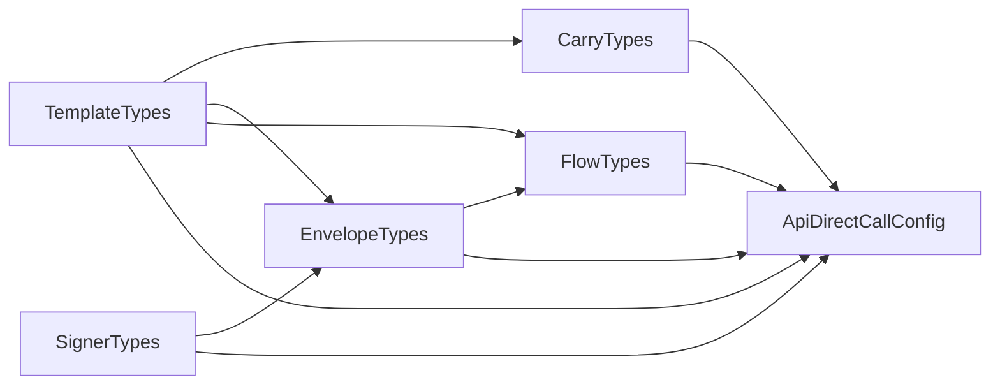

# Config Contracts (API-DIRECT-CALL)

> **Who this is for:** developers wiring a new API-direct bank, or auditing
> the type surface that powers the [API-DIRECT-CALL phase](../phases/api-direct-call.md).

The API-DIRECT-CALL config contract is the typed shape every API-direct bank
(Pepper, PayBox, OneZero, VisaCal, Isracard, Amex, Max, Mizrahi) compiles its `PipelineBankConfig.headless` literal
against. As of **v8.5** that shape lives in **six focused concern-slice files**
under `src/Scrapers/Pipeline/Mediator/ApiDirectCall/ConfigContracts/`, exported
through a single barrel. The legacy `IApiDirectCallConfig.ts` file was reduced
to a 14-line deprecated re-export shim in v8.5 and **deleted in v8.6**.

## File layout

```
src/Scrapers/Pipeline/Mediator/ApiDirectCall/
├── ConfigContracts/
│   ├── index.ts              ← barrel re-export (wide-import surface)
│   ├── TemplateTypes.ts      ← root bucket — no intra-cluster deps
│   ├── SignerTypes.ts        ← root bucket — no intra-cluster deps
│   ├── CarryTypes.ts         ← deps TemplateTypes
│   ├── EnvelopeTypes.ts      ← deps TemplateTypes + SignerTypes
│   ├── FlowTypes.ts          ← deps TemplateTypes + EnvelopeTypes
│   └── ApiDirectCallConfig.ts ← composes all five
```

The dependency graph is **acyclic** (`madge --circular` is part of the lint
ladder and reports zero cycles after every commit):



`TemplateTypes` and `SignerTypes` are independent roots; every other bucket
depends on `TemplateTypes`; only `EnvelopeTypes` and `ApiDirectCallConfig`
depend on `SignerTypes`.

## What each bucket owns

Each row lists the exact named exports of the sub-module (verified against
the source); the dependency column lists the ConfigContracts buckets it imports
from (cross-package imports such as `Registry/WK/*` are omitted for brevity).

| Bucket | Exports | Intra-cluster deps |
|---|---|---|
| **TemplateTypes** | `RefToken`, `JsonValueTemplate`, `IBodyTemplate`, `IEnvelopeSelectors` | (none) |
| **SignerTypes** | `SignerAlgorithm`, `AsymmetricSignerAlgorithm`, `SignerEncoding`, `CanonicalPart`, `ICanonicalStringConfig`, `IAsymmetricSignerConfig`, `IAesSignerConfig`, `IHmacHeaderSignerConfig`, `ISignerConfig`, `ICryptoFieldConfig` | (none) |
| **CarryTypes** | `IWarmStartConfig`, `ISeedCarrySource`, `IRandomHex16Bootstrap`, `IRandomUuidBootstrap`, `ISha256Prefix16Bootstrap`, `IJwtClaimBootstrap`, `SeedCarryBootstrapKind`, `IDerivedCarry` | TemplateTypes |
| **EnvelopeTypes** | `IFingerprintConfig`, `AuthScheme`, `IJwtClaimsConfig`, `IProbeConfig`, `IPreStepHook`, `PreHookReuse` | TemplateTypes, SignerTypes |
| **FlowTypes** | `FlowKind`, `StepName`, `StepMethod`, `IStepBase`, `IPostStep`, `IGetStep`, `IStepConfig`, `IStepOutcome`, `IOptionalExtract` | TemplateTypes, EnvelopeTypes |
| **ApiDirectCallConfig** | `IApiDirectCallConfig`, `IPersistentAuthConfig`, `CredRule` | all five above |

Notes:

- `ICryptoFieldConfig` is owned by `SignerTypes` (it describes a crypto-signing
  side-effect on the outbound body) and is consumed by `EnvelopeTypes` via
  `IPreStepHook.cryptoField`.
- `IPreStepHook` is owned by `EnvelopeTypes`; `FlowTypes.IStepBase.preHook`
  references it.

Every file is **≤ 150 effective LoC** (blank and comment lines skipped;
current max: `FlowTypes.ts` at 59) and is held there by an ESLint guard
(`eslint.config.mjs` §14) plus a canary fixture
(`EslintCanaries/no-api-direct-call-blob.canary.ts`).

## Which field does what

Where each login capability lives, and where its behaviour is documented.
Fields marked `headless.` sit in the bank's registry `headless` block, not in
this contract; the build-time checks read both.

| Capability | Field (type) | Bucket | Behaviour |
|---|---|---|---|
| GET or POST per step | `method` (`StepMethod`) | FlowTypes | [GET steps](../phases/api-direct-call.md#get-steps) |
| Extra request headers per step | `headers` | FlowTypes | [Step headers](../phases/api-direct-call.md#step-headers) |
| Response fields that may be absent | `optionalExtractsToCarry` (`IOptionalExtract`) | FlowTypes | [Optional extracts](../phases/api-direct-call.md#optional-extracts) |
| Login refused with HTTP 200 | `outcome` (`IStepOutcome`) | FlowTypes | [Step outcome](../phases/api-direct-call.md#step-outcome) |
| Bank state codes that change case | `outcome.caseInsensitive` | FlowTypes | [Step outcome](../phases/api-direct-call.md#step-outcome) |
| Bank error field in a 2xx body | `failIfPresent` | FlowTypes | [Bank-error guard](../phases/api-direct-call.md#bank-error-guard) |
| Checks on a value the bank sends back | `extractRules` (`IExtractRule`, `ExtractValueType`) | FlowTypes | [Extract rules](../phases/api-direct-call.md#extract-rules) |
| A step that runs only in some bank states | `runIf` (`IRunIf`) | FlowTypes | [Conditional steps](../phases/api-direct-call.md#conditional-steps) |
| Step identity and URL | `name` (`StepName`), `urlTag` | FlowTypes | [Step names and URL tags](../phases/api-direct-call.md#step-names-and-url-tags) |
| OTP prompt (absent: password-only) | `preHook` (`IPreStepHook`, `PreHookReuse`) | EnvelopeTypes, FlowTypes | [Password-only chains](../phases/api-direct-call.md#password-only-chains) |
| OTP hint, prerequisites and code shape | `preHook.hintFrom`, `preHook.requires`, `preHook.valuePattern` | EnvelopeTypes | [OTP pre-hook guards](../phases/api-direct-call.md#otp-pre-hook-guards) |
| Auth header form | `authScheme` (`AuthScheme`), `authPrefix` | EnvelopeTypes, ApiDirectCallConfig | [Auth-mode policy](../phases/api-direct-call.md#auth-mode-policy) |
| Credential shapes checked up front | `requiredCreds` (`CredRule`) | ApiDirectCallConfig | [Required credentials](../phases/api-direct-call.md#required-credentials) |
| Keep bank reply text out of missed extracts and login diagnostics | `omitBankText` | ApiDirectCallConfig | [Bank text in failures](../phases/api-direct-call.md#bank-text-in-failures) |
| How a stored token is judged | `warmStart.validation` | CarryTypes | [Build-time config checks](../phases/api-direct-call.md#build-time-config-checks) |
| Session held in cookies | `headless.sessionCookies` | — | [Headless transports](pipeline.md#headless-transports) |
| Cookies shared across sibling hosts | `headless.cookieDomains` | — | [Headless transports](pipeline.md#headless-transports) |
| Node's own `fetch`, no browser | `headless.nativeFetch` | — | [Headless transports](pipeline.md#headless-transports) |
| Bank-wide redirect handling | `headless.redirectPolicy` (`RedirectPolicy`) | — | [Redirect policies](pipeline.md#redirect-policies) |
| Redirect handling of one step | `redirect` (`RedirectPolicy`) | FlowTypes | [Redirect policies](pipeline.md#redirect-policies) |
| Bank-wide 2xx statuses decided before the body is read | `headless.statusPolicy` (`StatusPolicy`) | — | [Document responses and status policies](pipeline.md#document-responses-and-status-policies) |
| Keep bank text out of native HTTP failures, including data calls | `headless.omitBankText` | — | [Headless transports](pipeline.md#headless-transports) |
| Read one step's answer as a page, not JSON | `response` (`ResponseKind`), `documentMarker` | FlowTypes | [Document responses and status policies](pipeline.md#document-responses-and-status-policies) |
| Carry values the bank returns in response headers | `headerExtractsToCarry` (`IHeaderExtract`) | FlowTypes | [Response-header carry](pipeline.md#response-header-carry) |
| Carry slots built from one step's extracts | `deriveCarry` (`IDerivedCarry`) | FlowTypes | [Carry derivation](../phases/api-direct-call.md#carry-derivation) |
| Send one step's body as a URL-encoded form | `encoding` (`BodyEncoding`) | FlowTypes | [Form bodies](pipeline.md#form-bodies) |
| Seal a credential into one step's body | `seal` (`ISealFieldConfig`) | SignerTypes, FlowTypes | [Sealed fields](pipeline.md#sealed-fields) |
| Set client cookies before one step's request | `setCookies` (record of `RefToken`) | FlowTypes, TemplateTypes | [Client cookies](pipeline.md#client-cookies) |
| Read a cookie the bank set, URL-decoded | `cookie.<name>` (`RefToken`) | TemplateTypes | [Client cookies](pipeline.md#client-cookies) |

Cross-field rules (for example `authScheme: 'none'` needs
`headless.sessionCookies`) fail the build; see
[Build-time config checks](../phases/api-direct-call.md#build-time-config-checks).
A browserless bank warns about browser options it ignores; see
[Browser options on browserless banks](../configuration.md#browser-options-on-browserless-banks).

## Import patterns

### Wide-import (preferred when a call-site touches multiple buckets)

```ts
import type {
  IApiDirectCallConfig,
  ISignerConfig,
  IStepConfig,
} from '<rel>/Mediator/ApiDirectCall/ConfigContracts/index.js';
```

### Narrow per-bucket (preferred for surgical imports)

```ts
import type { ISignerConfig } from '<rel>/Mediator/ApiDirectCall/ConfigContracts/SignerTypes.js';
import type { IWarmStartConfig } from '<rel>/Mediator/ApiDirectCall/ConfigContracts/CarryTypes.js';
import type { IStepConfig, FlowKind } from '<rel>/Mediator/ApiDirectCall/ConfigContracts/FlowTypes.js';
```

### Legacy shim (removed in v8.6)

`Mediator/ApiDirectCall/IApiDirectCallConfig.ts` used to re-export the whole
barrel so historical importers kept compiling. Every importer has since moved
to one of the two patterns above and the shim is gone — there is no deprecated
path left to choose. Anything still naming it is stale and will not resolve.

## Why the split

The pre-v8.5 `IApiDirectCallConfig.ts` had grown to **369 LoC** as
Pepper/PayBox/OneZero accreted concerns over four phases — well above the
canonical **150 LoC** file ceiling enforced everywhere else under
`src/Scrapers/Pipeline/`. The split:

1. **Eliminates the type-sink hotspot.** Each new bank now imports
   only the buckets it actually touches; the fan-in is concentrated
   on `TemplateTypes` (universally used) rather than spread across
   one god-file that pulled every consumer through every change.
2. **Enforces SRP at the type layer.** ESLint `max-lines: 150` + a
   canary fixture prevent silent regrowth. `lint:guideline-coverage`
   tracks `ConfigContracts/**/*.ts` as the **4th** cluster
   (after `PiiRedactor`) with the canonical per-cluster profile
   (file 150 / per-fn 10 / complexity 10 / params 3).
3. **Preserved the public surface.** `lib/index.cjs` was
   **byte-identical** pre- and post-split[^byte-identical] — the barrel re-export
   kept every existing name, and while the shim existed every
   historical path through `IApiDirectCallConfig.ts` still resolved,
   so every importer compiled unchanged until it was migrated.

## Removal (completed in v8.6)

The `IApiDirectCallConfig.ts` shim shipped with a `@deprecated` JSDoc tag in
v8.5, so IDEs and the TypeScript language service surfaced a deprecation
indication at every import site. The v8.6 sweep then:

- Rewrote each historical `IApiDirectCallConfig.ts` import to either the
  barrel (`ConfigContracts/index.js`) or the narrow per-bucket form.
- Deleted `IApiDirectCallConfig.ts`.
- Confirmed `lib/index.cjs` remained byte-identical (only import paths in
  the type-tree changed — no public name was removed).[^byte-identical]

[^byte-identical]:
    Both byte-identical claims on this page are **historical records of what
    the author certified at the time**, kept as written. Neither should be
    read as evidence, and neither should be used as a template.

    The pre-PR contract in force then asked authors to verify the public
    surface by diffing `lib/index.cjs` against `main`. That check could not
    have run: `lib/` is gitignored and has never been tracked, so the
    `git show main:lib/index.cjs` half produced nothing and the comparison
    silently reported success. See
    [Public API surface gate](../workflow/public-surface.md#why-this-gate-exists)
    for exactly how it failed open.

    What the claims assert is still *plausible* — a barrel re-export that
    preserves every name would not change the emitted surface — but it was
    never demonstrated. The real check is now
    `npm run lint:public-surface`, which compares the exported API against
    the committed `api-surface.d.ts` snapshot and is enforced in the
    pre-commit `build` gate.

Deleting a file does not stop it being recreated, so the retired specifier is
now also held down by a lint rule (`Rule #17` in `LintValidator.ts`), which
fails the build and names the replacement path at the point of failure.

See the master plan at `phase-8.5-canonical-10/` for the canonical-10
sweep that lands alongside the shim removal.

## Related

- [API-DIRECT-CALL phase](../phases/api-direct-call.md) — runtime usage
  of these types
- [Pipeline architecture](pipeline.md) — overall phase model
- [Layer separation](layers.md) — where ConfigContracts sits in the layer
  graph (`types` layer, sub-cluster `pipeline-types`)
