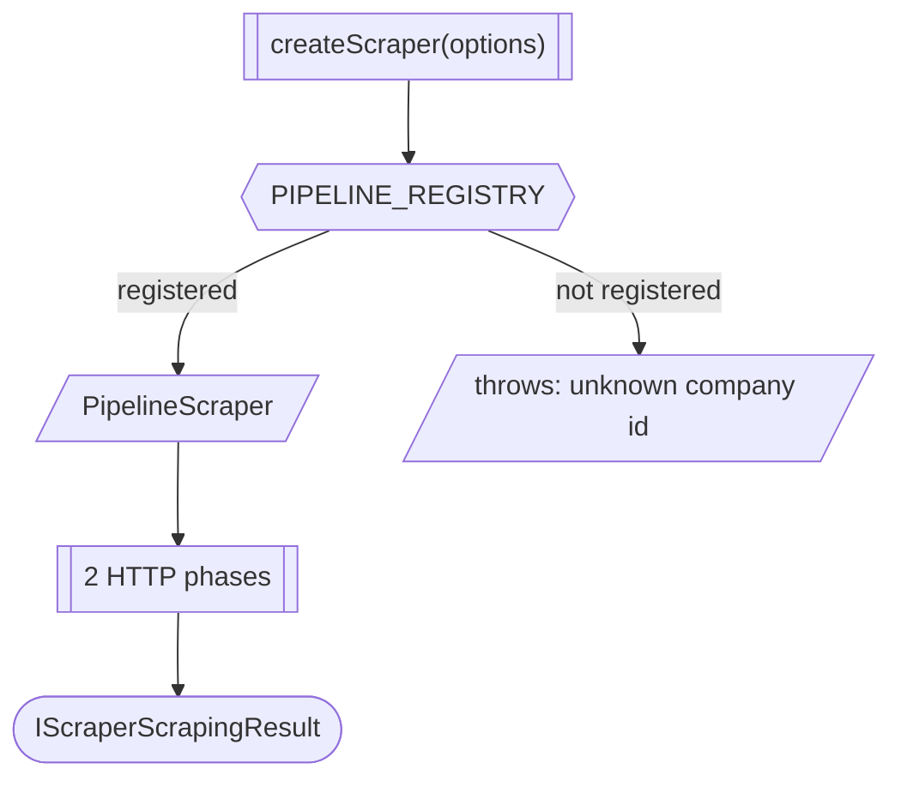

# Architecture

> **Who this is for:** developers building on, extending, or auditing the codebase.

The package is a **typed phase-based pipeline**. Banks register a declarative `PipelineDescriptor` and the executor drives the phases in order. Phases never reach into each other — communication happens via slim `Option<T>` fields on the shared `IPipelineContext`.

## Read in this order

1. **[Pipeline architecture](pipeline.md)** — the two HTTP-only phases, `IPipelineContext` and the `Procedure<T>` result pattern.
2. **[Layer separation](layers.md)** — the 8 logical layers (public-api, orchestration, mediator, strategy-registry, types, common-utilities, tests, build-ci) and how imports flow between them.
3. **[Config Contracts (api-direct-call)](config-contracts.md)** — the 6-bucket type split that replaces the legacy `IApiDirectCallConfig.ts` god-file in v8.5; the example that defines how every type-tree should be carved into ≤150-LoC concern slices.
4. **[JSON algebra](json-algebra.md)** — the single declaration site for JSON types, and why the closed (`JsonValue`) and open (`JsonUnknown`) arms stay distinct.
5. **[Transaction sign](transaction-sign.md)** — which side of zero a mapped amount lands on; the card-issuer inversion, and why a bank's numeric direction code outranks a worded one.
6. **[Transaction currency](transaction-currency.md)** — which code `originalCurrency` reports; why an ISO alias outranks a numeric enum, and why a blank value never wins.
7. **[Legacy (removed)](legacy.md)** — which retained `ScraperOptions` fields have no effect.
8. **[Migration strategy](migration.md)** — the historical migration and the current HTTP-only end state.

## At a glance

## Anchor invariants

| Invariant                                      | Where enforced                                                                                        |
| ---------------------------------------------- | ----------------------------------------------------------------------------------------------------- |
| Phases own state — no cross-phase reach        | Read-only `IPipelineContext` and architecture guardrails                                              |
| No browser or DOM interaction                  | API-direct configuration and HTTP response parsing only                                               |
| No raw PII in logs / captures                  | `PiiRedactor` runs as Pino's `redact.censor` + ESLint `PII-Log` rule                                  |
| No `null` / `undefined` returns from functions | ESLint `no-restricted-syntax` on return types                                                         |
| Pipeline-only dispatch in public entry         | `createScraper` resolves `PIPELINE_REGISTRY` and throws `unknown company id` for an unregistered bank |

## Source pointers

| File                                                                                                                                                                                   | Role                                                                                                                              |
| -------------------------------------------------------------------------------------------------------------------------------------------------------------------------------------- | --------------------------------------------------------------------------------------------------------------------------------- |
| [`src/Scrapers/Pipeline/Core/Builder/PipelineAssembly.ts`](https://github.com/sergienko4/israeli-bank-scrapers/blob/{{BRANCH}}/src/Scrapers/Pipeline/Core/Builder/PipelineAssembly.ts) | Declarative `PHASE_CHAIN` slot definitions                                                                                        |
| [`src/Scrapers/Pipeline/Banks/PipelineRegistry.ts`](https://github.com/sergienko4/israeli-bank-scrapers/blob/{{BRANCH}}/src/Scrapers/Pipeline/Banks/PipelineRegistry.ts)               | Merges the alphabetical-half sub-registries into `PIPELINE_REGISTRY` (`CompanyTypes → PipelineFactory`); Core stays bank-agnostic |
| [`src/Scrapers/Pipeline/Types/PipelineContext.ts`](https://github.com/sergienko4/israeli-bank-scrapers/blob/{{BRANCH}}/src/Scrapers/Pipeline/Types/PipelineContext.ts)                 | All shared types + `Option<T>` slots                                                                                              |
| [`src/Scrapers/Pipeline/Types/Procedure.ts`](https://github.com/sergienko4/israeli-bank-scrapers/blob/{{BRANCH}}/src/Scrapers/Pipeline/Types/Procedure.ts)                             | The `Procedure<T>` result-pattern primitive                                                                                       |
