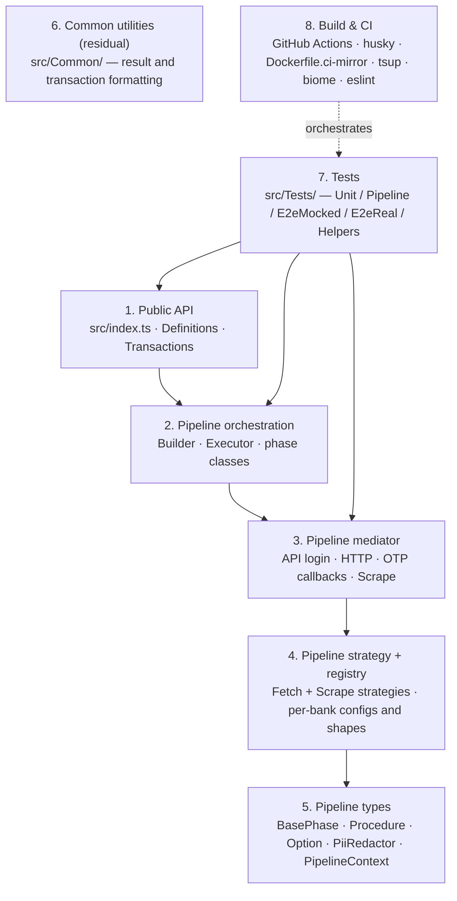

# Layer separation

The codebase is organised into **8 logical layers** (per the `/understand` knowledge-graph analysis). Every file belongs to exactly one. Imports flow downward — a higher layer may import from a lower one, never the reverse.

## Layer details

| #   | Layer                        | Path                                                                                                                                     | Status              |
| --- | ---------------------------- | ---------------------------------------------------------------------------------------------------------------------------------------- | ------------------- |
| 1   | Public API                   | `src/index.ts`, `src/Definitions.ts`, `src/Transactions.ts`, `src/Scrapers/Registry/Factory.ts`                                          | Stable              |
| 2   | Pipeline orchestration       | `src/Scrapers/Pipeline/Core/`, `src/Scrapers/Pipeline/Phases/`                                                                           | Canonical           |
| 3   | Pipeline mediator            | `src/Scrapers/Pipeline/Mediator/` (Api, ApiDirectCall, Network, Scrape, Timing)                                                          | Canonical           |
| 4   | Pipeline strategy + registry | `src/Scrapers/Pipeline/Strategy/`, `src/Scrapers/Pipeline/Banks/`, `src/Scrapers/Pipeline/Registry/`, `src/Scrapers/Registry/Factory.ts` | Canonical           |
| 5   | Pipeline types               | `src/Scrapers/Pipeline/Types/`, `src/Scrapers/Base/{Interface, ErrorTypes, ScraperError, Config/, Interfaces/}`                          | Shared infra        |
| 6   | Common utilities (residual)  | `src/Common/` (result and transaction formatting)                                                                                        | Test/result helpers |
| 7   | Tests                        | `src/Tests/Unit/`, `src/Tests/E2eMocked/`, `src/Tests/E2eReal/`, `src/Tests/Helpers/`, `src/Tests/Tools/`                                | Always-on gate      |
| 8   | Build & CI                   | `.github/workflows/`, `.husky/`, `tsup.config.ts`, `biome.json`, `eslint.config.mjs`, `tsconfig.json`                                    | Always-on gate      |

## What lives in layer 5

**Layer 5 (shared infra)** retains the public and pipeline contracts:

- `src/Scrapers/Base/Interface.ts` — `IScraper`, `IScraperScrapingResult`, `ScraperOptions`, `ScraperCredentials`
- `src/Scrapers/Base/ErrorTypes.ts` — `ScraperErrorTypes` enum
- `src/Scrapers/Base/ScraperError.ts` — error class
- `src/Scrapers/Base/Interfaces/**` — all sub-interfaces

The former legacy layer (the base scrapers, per-bank classes and their `src/Common/` helpers) was removed once no registered bank used it — see [Legacy (removed)](legacy.md).

## Well-known (WK) registry seeding and freeze

Layer 4's well-known URL and GraphQL query registries (`src/Scrapers/Pipeline/Registry/WK/UrlsWK.ts` and `QueriesWK.ts`) keep their backing maps module-private and follow a two-phase lifecycle:

1. **Module-load seeding:** `PipelineBankConfig.ts` seeds every bank's transport URLs via `seedWkFromPipelineConfig` (calling `@internal` `registerWkUrl`), and the GraphQL banks (`OneZeroQueries.ts`, `PepperQueries.ts`, statically imported through `PipelineRegistry.ts` and `src/Scrapers/Registry/Factory.ts`) register their operations via `@internal` `registerWkQuery` before any scrape begins.
2. **Freeze on first read:** the first `resolveWkUrl` or `resolveWkQuery` call marks its registry frozen (`ensureFrozen()`); any subsequent `registerWkUrl` or `registerWkQuery` call fails closed with a `ScraperError`. Unit tests that construct isolated fixtures explicitly clear the backing map and lift the freeze flag via `resetWkRegistryForTest`.

## Import direction enforcement

The architecture validator (`lint:architecture`) runs on every commit and rejects:

- Disallowed cross-layer imports
- Cross-mediator imports that bypass the declared contracts

Source: [`src/Tests/Tools/lint-and-validate.ts`](https://github.com/sergienko4/israeli-bank-scrapers/blob/{{BRANCH}}/src/Tests/Tools/lint-and-validate.ts) + the 3 architecture canaries under `src/Scrapers/Pipeline/EslintCanaries/`.
