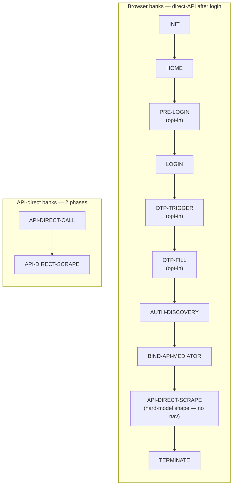

# Pipeline architecture

The pipeline is a **declarative chain of typed phases** orchestrated by `PipelineExecutor`. Each phase implements `BasePhase` and owns four sub-step hooks: `pre`, `action`, `post`, `final`. The executor drives them in order, threading an immutable `IPipelineContext` snapshot between phases.

## The phase chain (direct-API after login)



| Slot | Phase                                                                                                                                                                              | Always-on?      | Owner concern                                                                                                                                                                                                   |
| ---- | ---------------------------------------------------------------------------------------------------------------------------------------------------------------------------------- | --------------- | --------------------------------------------------------------------------------------------------------------------------------------------------------------------------------------------------------------- |
| 1    | [INIT](../phases/init.md)                                                                                                                                                          | ✅ browser      | Launch Camoufox, build the `IPipelineContext`, navigate to bank URL                                                                                                                                             |
| 2    | [HOME](../phases/home.md)                                                                                                                                                          | ✅ browser      | Landing-page discovery, signal login readiness                                                                                                                                                                  |
| 3    | [PRE-LOGIN](../phases/pre-login.md)                                                                                                                                                | ⚙️ opt-in       | Dormant — no bank opts in today                                                                                                                                                                                 |
| 4    | [LOGIN](../phases/login.md)                                                                                                                                                        | ✅ browser      | 7-strategy `SelectorResolver` + declarative `LoginConfig`                                                                                                                                                       |
| 5    | [OTP-TRIGGER](../phases/otp-trigger.md)                                                                                                                                            | ⚙️ opt-in       | Ask bank to dispatch SMS (Massad, Otsar Hahayal, Pagi)                                                                                                                                                          |
| 6    | [OTP-FILL](../phases/otp-fill.md)                                                                                                                                                  | ⚙️ opt-in       | Fill the code returned by `otpCodeRetriever`                                                                                                                                                                    |
| 7    | [AUTH-DISCOVERY](../phases/auth-discovery.md)                                                                                                                                      | ✅ browser      | Capture post-login auth token + API origin from network                                                                                                                                                         |
| 8    | `BIND-API-MEDIATOR`                                                                                                                                                                | ✅ browser      | Bind an authenticated `ApiMediator` to the live login page; prime bearer / session token from the capture pool                                                                                                  |
| 9    | [API-DIRECT-SCRAPE](../phases/api-direct-scrape.md)                                                                                                                                | ✅ all          | Walk the bank's typed hard-model shape (accounts + balances + transactions) over direct REST/GraphQL — no nav; `.final` emits `ctx.balanceResolution`                                                           |
| 10   | [TERMINATE](../phases/terminate.md)                                                                                                                                                | ✅ browser      | Close page/context/browser, finalise `IScraperScrapingResult`                                                                                                                                                   |
| —    | [API-DIRECT-CALL](../phases/api-direct-call.md)                                                                                                                                    | api-direct only | Replaces INIT…OTP-FILL for OneZero/Pepper/PayBox                                                                                                                                                                |
| —    | _dormant_: [ACCOUNT-RESOLVE](../phases/account-resolve.md) · [DASHBOARD](../phases/dashboard.md) · [SCRAPE](../phases/scrape.md) · [BALANCE-RESOLVE](../phases/balance-resolve.md) | —               | The retired generic navigation + DOM-scrape chain. Still in the codebase (ESLint canaries guard the boundary) but **no pipeline bank triggers them** — superseded by `BIND-API-MEDIATOR` + `API-DIRECT-SCRAPE`. |

## The Procedure result pattern

Every action returns `Procedure<T> = { success: true, value: T } | { success: false, errorType, errorMessage }`. Phases never throw exceptions across boundaries; they return Procedures and the executor consults `.success` to decide whether to advance.

```typescript
type Procedure<T> =
  | { readonly success: true; readonly value: T }
  | {
      readonly success: false;
      readonly errorType: ScraperErrorTypes;
      readonly errorMessage: string;
    };
```

| Helper            | Use                                                         |
| ----------------- | ----------------------------------------------------------- |
| `succeed(value)`  | Build the success branch                                    |
| `fail(type, msg)` | Build the failure branch                                    |
| `isOk(p)`         | Boolean type-guard                                          |
| `toLegacy(p)`     | Convert to the public `IScraperScrapingResult` shape        |
| `assertOk(p)`     | Test-only — `expect(p.success).toBe(true)` + type narrowing |

See [`Procedure.ts`](https://github.com/sergienko4/israeli-bank-scrapers/blob/{{BRANCH}}/src/Scrapers/Pipeline/Types/Procedure.ts).

## IPipelineContext — the shared state slot table

`IPipelineContext` is a discriminated record of `Option<T>` slots. Each phase reads the slots its `pre`/`action`/`post`/`final` declare, and writes only the slots it owns. The compiler enforces that no phase writes outside its declared scope.

Key slots (v8.6+):

| Slot                | Owner                                                              | Purpose                                                                                                                                                                                                                                                                                                                                                                                                                                                                             |
| ------------------- | ------------------------------------------------------------------ | ----------------------------------------------------------------------------------------------------------------------------------------------------------------------------------------------------------------------------------------------------------------------------------------------------------------------------------------------------------------------------------------------------------------------------------------------------------------------------------- |
| `browser`           | INIT                                                               | Playwright browser + context + page                                                                                                                                                                                                                                                                                                                                                                                                                                                 |
| `login`             | LOGIN                                                              | `persistentOtpToken`, `urlBeforeSubmit`                                                                                                                                                                                                                                                                                                                                                                                                                                             |
| `durableAuth`       | API-DIRECT-CALL.action                                             | `IDurableAuthState` — the long-lived re-login artifact minted by an api-direct login chain. api-direct banks never run LOGIN, so they cannot use the `login` slot (it carries a live `Page`/`Frame`); both slots feed the single public `result.persistentOtpToken` ([#576](https://github.com/sergienko4/israeli-bank-scrapers/issues/576))                                                                                                                                        |
| `apiMediator`       | BIND-API-MEDIATOR (browser) · headless context wiring (api-direct) | Authenticated `ApiMediator`. **Browser banks:** `BIND-API-MEDIATOR` commits a page-bound mediator to the live login page (+ any primed bearer / session token). **api-direct banks:** wired at context build by `resolveHeadlessApiMediator`, whose ordered transport rules pick `createMtlsHeadlessApiMediator` (client cert / TLS profile), `createHeadlessApiMediator` (`nativeFetch`) or `createBrowserBackedHeadlessApiMediator` (default), then consumed by `API-DIRECT-CALL` |
| `scrape`            | API-DIRECT-SCRAPE.post                                             | `accounts`, `accountIdentities` produced by the hard-model shape                                                                                                                                                                                                                                                                                                                                                                                                                    |
| `balanceResolution` | API-DIRECT-SCRAPE.final                                            | Final `Map<accountNumber, number>` → `PipelineResult`                                                                                                                                                                                                                                                                                                                                                                                                                               |
| _dormant_           | ACCOUNT-RESOLVE / DASHBOARD / BALANCE-RESOLVE                      | `accountDiscovery`, `txnEndpoint`, `dashboardTxnHarvest`, `balanceFetchPlan`, `balanceResponsesByBankAccount`, `balanceExtracted`, `balanceValidation` — slots of the retired generic chain; still declared on `IPipelineContext` but written by no pipeline bank                                                                                                                                                                                                                   |

> Both paths converge on the same `apiMediator` → `scrape` → `balanceResolution` slots. They differ only in **who mints the mediator**: `BIND-API-MEDIATOR` for browser banks (page-bound, post-auth); the headless context wiring — consumed by `API-DIRECT-CALL` — for api-direct banks.

The two paths converge on `balanceResolution` — that's the single source of truth read by [`PipelineResult.combineWithBalance`](https://github.com/sergienko4/israeli-bank-scrapers/blob/{{BRANCH}}/src/Scrapers/Pipeline/Core/PipelineResult.ts).

## Headless transports

An api-direct bank's `headless` config block picks the transport its identity calls run over. [`HeadlessMediatorWiring.ts`](https://github.com/sergienko4/israeli-bank-scrapers/blob/{{BRANCH}}/src/Scrapers/Pipeline/Core/HeadlessMediatorWiring.ts) decodes the block into an `IHeadlessWiring` (URLs plus the `IWiringFlags` booleans) and applies the rules in [`HeadlessTransportRules.ts`](https://github.com/sergienko4/israeli-bank-scrapers/blob/{{BRANCH}}/src/Scrapers/Pipeline/Core/HeadlessTransportRules.ts) in order; the first match wins:

| Order | Config                                                 | Kind       | Transport                                                       | Opens a browser | Factory                                  |
| ----- | ------------------------------------------------------ | ---------- | --------------------------------------------------------------- | --------------- | ---------------------------------------- |
| 1     | `requiresClientCert`, `clientCert` and/or `tlsProfile` | `node-tls` | `node:https` (client cert / dynamic cert / ClientHello profile) | No              | `createMtlsHeadlessApiMediator`          |
| 2     | `nativeFetch: true`                                    | `native`   | Node's own `fetch`                                              | No              | `createHeadlessApiMediator`              |
| 3     | anything else                                          | `browser`  | Camoufox page (browser TLS)                                     | Yes             | `createBrowserBackedHeadlessApiMediator` |

A block that declares more than one of `requiresClientCert`/`clientCert`/
`tlsProfile`, `nativeFetch` and `requiresBrowserTls` fails with a
`ScraperError` before a transport kind is returned or a mediator is built.
`assertSingleTransport` enforces this; `pickTransportKind` walks the table above.

`resolveHeadlessTransportKind(companyId)` returns the kind these rules pick without building a mediator. `createScraper` uses it to warn when a bank whose kind opens no browser is given browser options — see [Browser options on browserless banks](../configuration.md#browser-options-on-browserless-banks).

| Symbol                         | Module                      | Role                                                                        |
| ------------------------------ | --------------------------- | --------------------------------------------------------------------------- |
| `HeadlessTransportKind`        | `HeadlessWiringTypes.ts`    | The `Kind` column above — the rule a headless block matches                 |
| `resolveHeadlessTransportKind` | `HeadlessMediatorWiring.ts` | The kind for a bank, or `false` when it has no `headless` block             |
| `BROWSER_ONLY_OPTIONS`         | `BrowserOnlyOptions.ts`     | The browser option names, alphabetical, each pinned to its reader           |
| `BrowserOnlyOption`            | `BrowserOnlyOptions.ts`     | Union of those names                                                        |
| `findBrowserOnlyOptions`       | `BrowserOnlyOptions.ts`     | The browser options a caller actually supplied                              |
| `warnBrowserOnlyOptions`       | `BrowserOnlyOptions.ts`     | Emits the warning when the kind opens no browser; called by `createScraper` |

The native transport is [`HeadlessNativeFetchStrategy`](https://github.com/sergienko4/israeli-bank-scrapers/blob/{{BRANCH}}/src/Scrapers/Pipeline/Strategy/Fetch/HeadlessNativeFetchStrategy.ts), a `NativeFetchStrategy` with two changes:

- Every request, including any required body read, is capped at the constructor's `timeoutMs` option (`IHeadlessNativeFetchOptions`), which defaults to the shared 30 s `NETWORK_FETCH_TIMEOUT_MS`. A hung socket fails as `Timeout` (like the browser-backed transports) with `"<VERB> <url> network error: timeout"`; any other rejection keeps the inherited `toNetworkFailure` message.
- A GET sends no default `content-type`; a POST still sends `application/json`. The per-verb defaults are the strategy's `DefaultHeadersByVerb` seam; the base strategy sends JSON on both verbs. A caller `Content-Type` in any letter case replaces the default, as it does on the Camoufox transport, since `fetch` would otherwise join both values into one.

`INativeFetchOptions` gives native REST and GraphQL strategies the same bank-wide
redirect/status defaults and HTTP-failure body omission. `TRequest` and `IDispatch` are internal extension
contracts: a request becomes a dispatch with its own response-reading policy,
so concurrent headless calls do not overwrite each other's policy.
REST and GraphQL calls both honor `IApiQueryOpts.policy`: per-call redirect
settings override the bank default, and header sinks receive only declared headers.

With `headless.omitBankText: true`, native HTTP failures keep their verb, safe URL
and status, but replace the response snippet with `response body omitted`.
`classifyHttpFailure` still examines the body for WAF classification first;
fixed WAF reasons and error types are unchanged. Without this opt-in, generic
failures retain their existing snippets.

A bank whose session is a cookie, not an auth header, sets `sessionCookies: true`. Both node factories then pass their transport through `withCookieSession`; without `cookieDomains` it calls `withSessionCookies`, which wraps it in [`SessionCookieFetchStrategy`](https://github.com/sergienko4/israeli-bank-scrapers/blob/{{BRANCH}}/src/Scrapers/Pipeline/Strategy/Fetch/SessionCookieFetchStrategy.ts): one run-scoped `IOriginCookieJar` (built by `createOriginCookieJar`) that keeps one `ICookieJar` (built by `createSimpleCookieJar`) per origin. Every response's `Set-Cookie` feeds the jar of the origin that answered — the response's final URL when `fetch` followed a redirect, else the request URL — and every POST and GET sends only its own origin's cookies as one `cookie` header, replacing a caller cookie header in any letter case, since `fetch` would otherwise send both values. Under the default `follow` redirect policy `fetch` follows redirects itself, so a redirect hop's own `Set-Cookie` lines never reach the jar; a `manual` policy files them (see [Redirect policies](#redirect-policies)). The origin comes from the `FullyQualifiedUrl` the transport itself resolves (`resolveFetchUrl`: relative paths join the base URL), so a cookie never goes back to a different host, scheme or port, a `Domain` attribute never widens it, and a URL that cannot be parsed neither sends nor keeps a cookie. A later cookie of the same name replaces the earlier one; `Max-Age=0` (or less), or an `Expires` already past, deletes it (`Max-Age` wins when both are set); an empty jar adds no header; a caller's own `onSetCookie` hook still runs; cookie values are never logged. Without the flag the transport is returned unchanged. The browser transport ignores the flag, because the Camoufox page keeps its own jar.

A bank whose login hops across sibling hosts of one registrable domain also sets `cookieDomains` (for example `['bank.example']`). `withCookieSession` then builds the decorator over the RFC 6265 jar from [`createDomainCookieJar`](https://github.com/sergienko4/israeli-bank-scrapers/blob/{{BRANCH}}/src/Scrapers/Pipeline/Strategy/Fetch/DomainCookieJar.ts) instead of the origin jar, and returns an `ISessionTransport`: the decorated transport plus its `ICookieSession`, which the factory attaches to the mediator as `cookies` (the token bus a login flow sees; banks without `cookieDomains` get `cookies === undefined`).

- `parseSetCookie` (`SetCookieScope.ts`) turns one `Set-Cookie` line into an `IStoredCookie` (name, value, domain, path, `hostOnly`, `secure`, `expiresEpochS`, where `SESSION_EXPIRY` 0 marks a session cookie). It reuses the simple jar's `parseCookieLine`, `readAttribute` and `MAX_AGE_RE`. A `Domain` is kept only when it is in `cookieDomains` and the answering host `domainMatches` it; a `Domain` equal to a non-listed host stays host-only; any other `Domain` drops the cookie, so the allow-list stands in for a public-suffix list. The jar consults no public-suffix list, so `cookieDomains` is reviewed first-party config: it lists only the bank's own registrable domains, never a public suffix such as `co.il`. A missing or relative `Path` takes the `defaultPath` of the request. `Max-Age` beats `Expires`, and a past expiry deletes the stored cookie. An attribute is named by its text before any `=`, so `Secure=true` marks the cookie `Secure`.
- `IDomainCookieJar` keys cookies by name + domain + path: a new cookie replaces a live stored cookie with that key in place (keeping its creation order), whether it is host-only or a domain cookie. Recreating an expired key gets a new creation order. `targetOf` resolves a request URL into an `ICookieTarget` (host, path, scheme) the way the transport resolves it; `cookieApplies` sends a cookie only when the host matches, the path matches on a `/` boundary, it has not expired (`isExpired` against `nowEpochS`) and, if `Secure`, the URL is https. Matching cookies go out longer path first, then in creation order. An unparseable URL neither keeps nor sends a cookie.
- `ICookieSession` is the narrow port onto that same jar: `cookieFor(url, name)` reads one applicable value, `headerFor(url)` returns the header the transport would send, `set(url, cookie)` stores an `IClientCookie` host-only to the URL's host (default path `/`, `Secure`, session lifetime), `exportAll()` lists unexpired cookies, `importAll(list)` replaces the whole jar, and `clear()` empties it. Every way into the jar refuses a cookie that cannot travel as `name=value` in a `cookie` header (an empty name, `=` in the name, `;` or a byte outside the field-value set in either part: `isSendableCookie` in `HeaderText.ts`) or whose path does not start with `/`, and `importAll` also refuses a domain cookie whose domain is not in `cookieDomains`. Cookie values are never logged.
- A request header whose value is the sentinel `@cookie:<name>` (`COOKIE_HEADER_SENTINEL_PREFIX` in [`CookieHeaderSentinel.ts`](https://github.com/sergienko4/israeli-bank-scrapers/blob/{{BRANCH}}/src/Scrapers/Pipeline/Strategy/Fetch/CookieHeaderSentinel.ts)) echoes a cookie, as an anti-replay `X-XSRF-TOKEN` does. Over a domain jar the session decorator resolves it before dispatch with `substituteCookieHeadersBy` and a `CookieLookup` built on `cookieFor(url, name)`: the value is URI-decoded (a malformed escape, or a decoded value `isHeaderSafe` refuses as a field value, is sent raw), and the header is dropped when no cookie of that name applies to the request URL under the jar's domain and path rules. The headers `cookieSentinelHeaders` picks out are resolved again for every manual redirect hop (see [Redirect policies](#redirect-policies)). The `cookie` header itself keeps the stored, undecoded values. An origin jar leaves header values unchanged. The browser transport keeps resolving the sentinel against the page's own cookies through `substituteCookieHeaders`, which now delegates to the same lookup form.

`exportAll()` returns detached records, and `importAll(list)` copies accepted
records, so mutations outside the cookie-session port cannot change the live jar.

### Dynamic client certificate

A bank whose login obtains its device certificate at runtime (the flow builds a CSR and the bank issues the certificate) declares `clientCert: { mode: 'dynamic', origin }` on its headless block: an `IDynamicClientCert` from [`ClientCertControl.ts`](https://github.com/sergienko4/israeli-bank-scrapers/blob/{{BRANCH}}/src/Scrapers/Pipeline/Types/Domain/ClientCertControl.ts), whose `origin` is the exact https origin the certificate is presented to. The block then runs over `node-tls`, and `createMtlsHeadlessApiMediator` builds the agent source its two transports share with `buildTransportSource` ([`ApiMediator.nodeTransport.ts`](https://github.com/sergienko4/israeli-bank-scrapers/blob/{{BRANCH}}/src/Scrapers/Pipeline/Mediator/Api/ApiMediator.nodeTransport.ts)):

- `createClientCertHolder(origin, buildAgent)` ([`ClientCertHolder.ts`](https://github.com/sergienko4/israeli-bank-scrapers/blob/{{BRANCH}}/src/Scrapers/Pipeline/Strategy/Fetch/Mtls/ClientCertHolder.ts)) returns an `IClientCertHolder`: the per-request `AgentSource` and the `IClientCertControl` port, which the factory attaches to the mediator as `clientCert` (on the token bus a login flow sees; every other bank has `clientCert === undefined`). A login step installs through it with its own `clientCert` field ([Device certificate](../phases/api-direct-call.md#device-certificate)). Its `AgentBuilder` carries the bank's `tlsProfile` and the server-certificate floor.
- `install(pair)` takes an `IClientCertPair` (PEM key, PEM certificate). A pair that does not parse, or whose certificate does not certify its key, fails `Generic` with `"client certificate invalid"` and the previous certificate stays. Otherwise the holder builds an agent presenting the pair, swaps it in and destroys the agent it replaced. `clear()` drops the certificate and destroys its agent. The pair lives only in memory for the run and is never logged or written.
- `makeMtlsInvoke` asks the source on every request and gets an `IAgentChoice` (the agent and the `IPresentedCert` it presents). A request whose `URL.origin` equals the declared origin goes through the installed agent; any other origin, and every request before an install or after a clear, goes through a plain agent that presents no certificate.
- The `node:https` transport does not follow redirects automatically: a 3xx under its default `follow` is an HTTP failure. A step may explicitly `reject` redirects; manual redirects require a native-fetch-only bank default, so node-tls cannot enable them. The dynamic certificate is presented only to its declared origin.
- A bank with a registered certificate (`requiresClientCert`) or none keeps one shared agent behind `fixedAgentSource` ([`MtlsAgentSource.ts`](https://github.com/sergienko4/israeli-bank-scrapers/blob/{{BRANCH}}/src/Scrapers/Pipeline/Strategy/Fetch/Mtls/MtlsAgentSource.ts)); `presentedOf` names the certificate it presents.
- The E2E-mocked seam `setMtlsFetchFallback` takes an `MtlsFallback`, called with one `IMtlsFallbackRequest` (URL, init, verb and `presented`: the certificate's SHA-256, or `false` for none), so a mocked suite can prove which requests would carry the certificate without a handshake.

### Redirect policies

The native transport sends every request under a `RedirectPolicy` ([`FetchPolicy.ts`](https://github.com/sergienko4/israeli-bank-scrapers/blob/{{BRANCH}}/src/Scrapers/Pipeline/Types/Domain/FetchPolicy.ts)). The bank-wide default is `headless.redirectPolicy` (absent: `follow`), which the factory hands to `HeadlessNativeFetchStrategy` as its `redirectPolicy` option; one api-direct step overrides it with its own `redirect` field, carried down as an `IFetchCallPolicy` (`IApiQueryOpts.policy`, which `IFetchOpts` extends). The browser ignores it; node:https honors a step's `reject` but not the bank-wide default.

| Policy                                 | Sends                | On a 3xx                                                                                     |
| -------------------------------------- | -------------------- | -------------------------------------------------------------------------------------------- |
| `follow`                               | the request as-is    | `fetch` follows it; the final response comes back with its own URL                           |
| `reject`                               | `redirect: 'manual'` | fails `Generic` with `"<VERB> <url> HTTP <status> redirect refused"`                         |
| `IManualRedirect` `{ maxHops, allow }` | `redirect: 'manual'` | follows 301/302/303/307/308 itself, up to `maxHops`, only to a target an `allow` rule admits |

`reject` still applies the refused response's `Set-Cookie` updates and calls
the caller's cookie hook once, under the answering URL, without following the redirect.
`isRedirectStatus` supplies the shared 3xx boundary for redirect handling
and the capped transport. Under `reject` or `manual`, the cap releases those
bodies at headers instead of buffering them, so a stalled body cannot delay
the refusal, cookie updates or the next allowed hop.

[`sendUnderPolicy`](https://github.com/sergienko4/israeli-bank-scrapers/blob/{{BRANCH}}/src/Scrapers/Pipeline/Strategy/Fetch/RedirectFollow.ts) runs one `IRedirectRun` (URL, init, verb, the transport's `FetchInvoke` sender and its `HttpVerb`, the `onSetCookie` hook and an optional `sessionHeadersFor`) and returns an `IRunEnd`: the final response and the URL its cookies belong to. Under `manual`:

- Each hop is a body-less GET sent with `redirect: 'manual'` through the same sender, so every hop keeps the 30 s cap. Its headers start from the previous hop's. Every header the session owns (`ISessionHeaders.owned`: `cookie` and each `@cookie:` header, lower-cased) is replaced by the session's `values` for the hop URL, from `sessionHeadersFor(hopUrl)`. The session decorator computes them from its jar, so each hop carries only the cookies and echoed cookie values that apply to it. Once any hop changes origin, `authorization` and `proxy-authorization` are dropped after the session's values are added, as the Fetch standard requires, so neither the caller's nor a session-owned one is sent on that hop or any later one, even a later same-origin hop. Without a session, `cookie` alone is replaced (dropped).
- `emitSetCookies` hands each redirect's `Set-Cookie` lines to the hook under that hop's URL (the request URL when the response has none) before the next hop is built, so a cookie set on one hop goes out on the next.
- A relative `Location` resolves against the hop URL. [`matchesAnyUrlRule`](https://github.com/sergienko4/israeli-bank-scrapers/blob/{{BRANCH}}/src/Scrapers/Pipeline/Strategy/Fetch/UrlRule.ts) admits a target only when it is clean https (no userinfo, no fragment), its `URL.origin` equals an `IUrlRule`'s `origin`, and the rule's path terms hold. An exact-path rule (`IExactPathRule`) needs a path that is one of its `paths` and a query that holds its `query` pairs once each (with `exactQuery`, nothing else). An any-path rule (`IAnyPathExceptRule`) admits any path and query whose lower-cased path contains none of its `anyPathExcept` texts, compared case-insensitively.
- A missing or unparseable `Location`, a 300 or 304, a refused target or a hop past `maxHops` fails `Generic` with `"<VERB> <url> redirect refused"`, naming only the first request's log-safe URL; the `Location` is never logged. A hop's transport failure comes back unchanged.
- An api-direct config names a manual policy only in a GET step's `redirect`. The [build-time config checks](../phases/api-direct-call.md#build-time-config-checks) refuse it as the bank default or on a POST step, refuse an empty `allow` or a `maxHops` outside 1–10, and require the bank default `reject` beside it.

### Document responses and status policies

Once a response answers, the native transport wraps it in an `IAnswer` (response, verb, URL and the `IResponseReading` built from the bank's status policy plus the call's `responseKind`, `documentMarker`, `mediaType` and `strictUtf8`) and routes it in a fixed order, so a bank without a policy reads its answers exactly as before:

1. A non-2xx answer, or any answer carrying Cloudflare's challenge header, goes to the WAF classifier first. A block page or challenge on a document step is still a `WafBlocked` failure, never `{}`.
2. [`applyStatusPolicy`](https://github.com/sergienko4/israeli-bank-scrapers/blob/{{BRANCH}}/src/Scrapers/Pipeline/Strategy/Fetch/StatusPolicy.ts) then checks the bank's `headless.statusPolicy` (a `StatusPolicy`, handed to `HeadlessNativeFetchStrategy` as its `statusPolicy` option). Before the body is read, the `StatusAction` `empty` answers `{}` (`emptyAnswer`) and `fail` fails `Generic` with `"<VERB> <url> HTTP <status>"`. A document step skips `empty`, so a 204 reaches the document reader as an empty page.
3. [`refuseMediaType`](https://github.com/sergienko4/israeli-bank-scrapers/blob/{{BRANCH}}/src/Scrapers/Pipeline/Strategy/Fetch/MediaTypeCheck.ts) (N61) then checks the answer's media type, when the call expects one: the call's own `mediaType`, else the bank's `headless.mediaTypes` default for the call's response kind (a `MediaTypePolicy`, handed to `HeadlessNativeFetchStrategy` as its `mediaTypes` option and kept on the `_mediaTypes` seam). The answer's media type is its `content-type` before any `;`, trimmed and lower-cased, and must equal the expected one exactly; a missing or different type fails `Generic` with `"<VERB> <url> unexpected media type"` (`MEDIA_TYPE_REFUSED_REASON`), naming no header value. A call that expects none is read as before.
4. The reader the call's `responseKind` names reads the body, each through [`readBodyText`](https://github.com/sergienko4/israeli-bank-scrapers/blob/{{BRANCH}}/src/Scrapers/Pipeline/Strategy/Fetch/BodyText.ts) (N63): when the call's `strictUtf8` — else the bank's `headless.strictUtf8`, handed to `HeadlessNativeFetchStrategy` as its `strictUtf8` option and kept on the `_strictUtf8` seam — is true, it decodes the bytes as UTF-8 with `fatal`, so a malformed byte fails `Generic` with `"<VERB> <url> body not utf-8"` (`BODY_NOT_UTF8_REASON`), naming no body, instead of becoming U+FFFD; otherwise it reads them as `text()` does. Both drop a leading BOM. `json` (the default) parses it as before, so HTML on a json step is still a parse error. `document` ([`readDocument`](https://github.com/sergienko4/israeli-bank-scrapers/blob/{{BRANCH}}/src/Scrapers/Pipeline/Strategy/Fetch/DocumentResponse.ts)) reads it as text, checks it for the call's `documentMarker` when one is set (otherwise it fails `Generic` with `"<VERB> <url> document unverified"`), and answers `{}`. `text` ([`readText`](https://github.com/sergienko4/israeli-bank-scrapers/blob/{{BRANCH}}/src/Scrapers/Pipeline/Strategy/Fetch/TextResponse.ts)) reads it as text and answers `{ text }`, so a step's extracts read it at `/text`; an answer over the call's `maxTextChars` (65 536 chars by default) fails `Generic` with `"<VERB> <url> text too long"`. The fixed tails `DOCUMENT_UNVERIFIED_REASON`, `TEXT_TOO_LONG_REASON`, `MEDIA_TYPE_REFUSED_REASON`, `BODY_NOT_UTF8_REASON` and `REDIRECT_REFUSED_REASON` live in `FetchPolicy.ts`, shared by the transport and the step sanitiser.

For JSON answers, `parseJsonResponse` reads with the call's UTF-8 policy before
parsing, so malformed bytes fail as a decoding error instead of a JSON error.
Rejected body reads fail `Generic` with `"<VERB> <url> body read failed"`,
without exposing rejection details.

The `FetchInvoke` seam carries an `IFetchInvokePolicy` with the verb and
expected media type through each redirect hop. The node:https transport
checks API-success headers before collecting the body: a mismatch closes
the stream and returns its headers to the shared router, preserving cookies,
WAF classification and status-policy precedence without waiting for a body.
The native REST and GraphQL transports share the bank's media-type and strict
UTF-8 defaults; a call's own policy still wins. The node:https transport
retains raw response bytes through `collectBody` and `toResponse`; otherwise
an earlier lossy decode would hide malformed bytes from the later strict
reader.

`isApiSuccess`, `statusActionFor` and `isMediaTypeMismatch` are shared by response
routing and the capped headless transport. When the status or media-type policy
decides from headers, only that request's body is cancelled; undecided,
challenged and document-empty responses still need a body read under the cap.
A per-query empty-status notification preserves an approved GraphQL empty
result without accepting a parsed `{}` as a valid GraphQL envelope or sharing
the verdict with another query.

[`cancelResponseBody`](https://github.com/sergienko4/israeli-bank-scrapers/blob/{{BRANCH}}/src/Scrapers/Pipeline/Strategy/Fetch/ResponseBody.ts)
releases bodies discarded by status decisions or redirect handling, including
uncapped GraphQL responses. Cancellation failures retain the policy verdict
and emit a warning containing only the verb, log-safe URL and a fixed message;
neither response content nor cancellation error text is logged. Responses
left to a reader, including document-marker and WAF checks, remain untouched.

An api-direct step opts in with `response: 'document'` and an optional
`documentMarker` (it names no body extracts — a build-time check), or with
`response: 'text'` and an optional `maxTextChars`; `callPolicyOf` carries them
down as `IFetchCallPolicy.responseKind` / `documentMarker` / `maxTextChars`,
next to `redirect`, with a step's `mediaType` and `strictUtf8` as
`IFetchCallPolicy.mediaType` / `strictUtf8`.
The step-level sanitiser keeps these refusals' fixed tails (`bind HTTP 207`,
`bind HTTP 302 redirect refused`, `bind document unverified`,
`bind unexpected media type`, `bind body not utf-8`) only when the whole
message has a policy refusal's shape, so no response text can pass for one.

### Response-header carry

A step can carry values the bank returns in response headers. `headerExtractsToCarry` maps a carry slot to an `IHeaderExtract`: a `header` name, compared case-insensitively, and an optional `fallback`. [`attachHeaderCapture`](https://github.com/sergienko4/israeli-bank-scrapers/blob/{{BRANCH}}/src/Scrapers/Pipeline/Mediator/ApiDirectCall/Flow/RunStep.headerCarry.ts) builds the step's `IHeaderCapture`. Its `IResponseHeaderSink` (the lower-case header `names` and a `take` receiver, handed each answer's declared headers, its HTTP status and the URL that gave it) rides down as `IFetchCallPolicy.headerSink`, next to `redirect`. The map that sink fills stays on the step's fire args and never reaches the bus.

The native transport hands the final response to [`emitResponseHeaders`](https://github.com/sergienko4/israeli-bank-scrapers/blob/{{BRANCH}}/src/Scrapers/Pipeline/Strategy/Fetch/ResponseHeaderSink.ts), next to the Set-Cookie hook. `emitResponseHeaders` passes the sink only the declared headers the response carried. Each `take` replaces what the sink held, so when a call is retried after a 401 only the last answer's headers and URL count. A step that names `finalUrlInto` (N51) gets the same capture, with no declared headers if it reads none, and carries that URL — see [Final URL carry](../phases/api-direct-call.md#final-url-carry). After the outcome is judged and the required extracts are read, `carryHeaders` fills each slot from its header, else from its `fallback`, else fails the step `Generic` with `"<step> header missing"`. Optional extracts are read after the header slots. The browser, Camoufox and TLS transports ignore the sink, so a declared header slot on them fails closed. Header values are never logged.

### Form bodies

A POST step sends JSON unless it names another `BodyEncoding`: `form`, `form-utf8`, `form-latin1` or `text`. `callPolicyOf` carries the encoding down as `IFetchCallPolicy.bodyEncoding`, next to `redirect` and `responseKind`. [`writePostBody`](https://github.com/sergienko4/israeli-bank-scrapers/blob/{{BRANCH}}/src/Scrapers/Pipeline/Strategy/Fetch/PostBody.ts) then writes the body: `json` as JSON text, `form` as `application/x-www-form-urlencoded` pairs in config order. `form-utf8` writes the same UTF-8 pairs under exactly `application/x-www-form-urlencoded;charset=UTF-8` — no space, as a bank's own client labels them. `form-latin1` writes the same pairs through [`encodeLatin1Form`](https://github.com/sergienko4/israeli-bank-scrapers/blob/{{BRANCH}}/src/Scrapers/Pipeline/Strategy/Fetch/Latin1Form.ts), which encodes like Java's `URLEncoder` over ISO-8859-1 (`A-Z a-z 0-9 . - * _` kept, a space as `+`, every other char as its `%XX` latin1 byte) and sends them under `application/x-www-form-urlencoded; charset=ISO-8859-1`. `text` sends the one string field of a `{ text }` body verbatim. `withBodyContentType` puts the body's content-type in place of any content-type the bank's headers name — or, for `text`, removes it — so a body never travels labelled as something it is not. A call that names no encoding is sent byte for byte as before.

A writer refuses a body it cannot write, before any request, failing `Generic` with `"POST <url> <reason>"`: `form-latin1 unencodable` (`LATIN1_UNENCODABLE_REASON`) when a name or value holds a char above U+00FF, and `text body not a string` (`TEXT_BODY_REFUSED_REASON`) when a `text` body is not exactly one string field named `text`. The step sanitiser keeps both tails, so the step fails `<step> form-latin1 unencodable` or `<step> text body not a string`, naming no value.

A form body (either form encoding, the `FORM_BODY_ENCODINGS`) must be a flat record, or one `$merge` (N37) that lays a flat record over a carried form, and a `text` body must be shaped exactly `{ text }`. The build refuses a nested form shape, a loose text shape or a `$merge` anywhere else (`API_DIRECT_FORM_RULES`), and at run time [`guardFormBody`](https://github.com/sergienko4/israeli-bank-scrapers/blob/{{BRANCH}}/src/Scrapers/Pipeline/Mediator/ApiDirectCall/Flow/RunStep.form.ts) fails the step with `<step> form body not flat` before any request when a `$ref` hydrates to an array, an object, `null` or a non-finite number. The failure names no value. Only the native transports write form bodies, so `encoding` off native fetch fails the build.

### Sealed fields

A step can seal one credential into its body. `seal` names an `ISealFieldConfig`: a `kind` (a `SealKind`), the `sourceRef` credential (`creds.*`), the `modulusRef` carry slot that holds the bank's RSA modulus as hex (`carry.*`), the `writeTo` JSON pointer and the kind's `params`. [`applySeal`](https://github.com/sergienko4/israeli-bank-scrapers/blob/{{BRANCH}}/src/Scrapers/Pipeline/Mediator/ApiDirectCall/Flow/RunStep.seal.ts) runs after `cryptoField` and before the AES body signature and `guardFormBody`. It looks the sealer up in `SEALERS`, where each `Sealer` takes an `ISealInput` (the credential, the modulus hex and the params), and writes the result only at `writeTo`: neither the credential nor the sealed text is copied into carry.

The one kind today is `rsa-pkcs1-block-xor`, whose `ISealRsaBlockXorParams` the bank config names in full: `exponent`, `seedAlphabet`, `seedLength`, `blockChars`, `prefix`, `blockSeparator` and `envelopeTerminator`. [`sealRsaBlockXor`](https://github.com/sergienko4/israeli-bank-scrapers/blob/{{BRANCH}}/src/Scrapers/Pipeline/Mediator/ApiDirectCall/Crypto/SealRsaBlockXor.ts) draws a fresh seed with `crypto.randomInt`, splits `prefix` + seed into `blockChars` chunks, encrypts each chunk with RSA PKCS#1 v1.5 under the bank's public key, and joins the hex blocks with `blockSeparator`, ending with `envelopeTerminator`. [`sealTail`](https://github.com/sergienko4/israeli-bank-scrapers/blob/{{BRANCH}}/src/Scrapers/Pipeline/Mediator/ApiDirectCall/Crypto/SealTail.ts) XORs each UTF-16 unit of the credential with the cycled seed and percent-encodes the result. The sealed value is the envelope plus the tail as URL-safe base64, padding kept. Tests pass `sealRsaBlockXor` a fixed `SeedSource` in place of the random draw.

A step fails before any request, naming no value: `<step> seal key invalid` when the modulus slot is missing, is not even-length odd hex of 128 to 2048 digits, or yields a key under 512 bits; `<step> seal source invalid` (`SOURCE_INVALID`) when the credential is missing, empty, longer than 256 characters or holds a lone surrogate; `<step> seal writeTo invalid` when the pointer does not resolve in the body. The build refuses an unknown kind, a seal off a POST record body, a `writeTo` that is not a JSON pointer, and params out of range (`API_DIRECT_SEAL_RULES`).

### Client cookies

A login step can set cookies the bank expects the browser to have written, and read cookies the bank set. On a run with a domain jar (`headless.cookieDomains`), [`bindStepCookies`](https://github.com/sergienko4/israeli-bank-scrapers/blob/{{BRANCH}}/src/Scrapers/Pipeline/Mediator/ApiDirectCall/Flow/RunStep.clientCookies.ts) runs first in every step: it binds a jar view to the step URL before the URL, body or headers resolve. A `cookie.<name>` ref reads through that view: [`resolveCookieRef`](https://github.com/sergienko4/israeli-bank-scrapers/blob/{{BRANCH}}/src/Scrapers/Pipeline/Mediator/ApiDirectCall/Template/CookieRef.ts) takes the raw value of the cookie that applies to the step URL, as a `CookieLookup` returns it, and URL-decodes it. Scrape steps get no jar view, so a `cookie.<name>` ref there misses.

`setCookies` maps cookie names to refs. Every ref resolves, and must be a string of 1 to 4096 RFC 6265 cookie-octets, before any cookie is written; then each is written host-only with `Path=/` and `Secure`, so it travels on the step's own request and on later requests to that host.

A step fails before any request, naming no value: `ref cookie.<name> miss` when no cookie applies or the run has no domain jar; `ref cookie.<name> bad` when the raw value is over 4096 characters or holds a malformed escape; `<step> setCookies <name> invalid` when a ref does not resolve to cookie-octets; `<step> setCookies needs a cookie session` when the run has no cookie jar. The build refuses `setCookies` without `headless.cookieDomains`, and a cookie name that is not an HTTP token (`API_DIRECT_NATIVE_RULES`).

## contextIds — addressing a frame across the PRE→ACTION seal

`buildActionContext` seals the raw `Page` away before `action()` runs, so
ACTION cannot hold a `Frame` reference that PRE discovered. Instead PRE mints
an opaque **contextId** for the frame it resolved, and ACTION rebuilds a
registry from the live page and looks the id back up.

| Stage  | Call                            | What happens                                        |
| ------ | ------------------------------- | --------------------------------------------------- |
| PRE    | `computeContextId(frame, page)` | Mints the id, stored on `IResolvedTarget.contextId` |
| ACTION | `buildFrameRegistry(page)`      | Snapshots `page.frames()` at action-entry           |
| ACTION | `resolveFrame(registry, id)`    | Maps the id back to a live `Frame`                  |

The id has two halves, `<token>|<base>`, and each covers the other's blind
spot.

The **base** is content-derived — `iframe:<origin><pathname>` for a real URL,
`iframe:<frame.name()>` for `about:blank`. The query string is stripped on
purpose: a session token in the URL changes between PRE and ACTION, and an id
that embedded it would stop resolving.

Content is stable but not unique. Two sibling iframes can share an
origin+pathname (differing only in the stripped query), and two unnamed
`about:blank` frames both reduce to the bare prefix. So the id also carries a
**token** — an opaque per-`Frame` identity minted from a `WeakMap`. It pins
the exact frame instance, and because it is keyed on the object it never
changes when a sibling attaches or detaches. Without it the registry silently
kept only the last writer, and a credential could be typed into a frame that
was never resolved.

When a frame's base is **already shared** at mint time, `computeContextId`
drops the base entirely and returns the bare token. Such an id is
identity-only: it resolves while that exact frame lives and refuses once it
dies, so it can never content-fall-back onto a surviving sibling. The cost is
cosmetic — an ambiguous frame logs as `f7` with no human-readable base.

Because that shape has no `<token>|<base>` split, the registry reads each
frame's token from the frame itself rather than parsing it back out of the id
it just minted. Every frame is therefore indexed by identity whatever shape
its id took, and no registry key is ever empty — an empty key would be
claimed by each ambiguous sibling in turn and hand the last writer back to
any caller with a blank id.

`resolveFrame` narrows in three steps. The full id is an exact
content-and-identity match. The bare token alone still pins the same live
frame after it navigated and its content-derived base changed. Only once
identity is gone — the frame detached and re-attached as a new object — does
resolution fall back to the bare base id, matching on content the way it did
before the token existed.

That last fallback is only registered when the base id is **unique** among the
live frames. If two siblings share a base, neither claims it, and an id that
reaches the fallback resolves to nothing rather than to an arbitrary sibling —
`resolveFrame` throws. Guessing here would type a credential into a frame that
was never resolved, so refusing is the safer failure. Positional
disambiguation is not an option: a re-attached frame moves to the back of
`page.frames()`, so an ordinal recorded at PRE points at a different frame by
ACTION and would resolve confidently to the wrong one.

Consumers that need to ask "is this the same context?" compare with
`isSameContext(page, a, b)`, not `===`. Two ids alone cannot answer the
question — the same string comparison that unites a re-attached frame with its
former self also unites two live siblings. So the comparison resolves both ids
against the live page and re-mints them, giving three outcomes:

| Outcome                | When                                               |
| ---------------------- | -------------------------------------------------- |
| Definitely the same    | Both ids resolve, and re-minting yields one id     |
| Definitely different   | Both resolve, but to two frames that are alive now |
| Unprovable → different | Either id no longer resolves to any live frame     |

Identical strings short-circuit to `true` before any resolution. The
"unprovable" case is deliberately conservative: a caller that cannot prove two
ids name one frame must not act as if they do.

Source: [`FrameRegistry.ts`](https://github.com/sergienko4/israeli-bank-scrapers/blob/{{BRANCH}}/src/Scrapers/Pipeline/Mediator/Elements/FrameRegistry.ts).

## Interceptors — cross-cutting, no data

| Interceptor          | Runs between                        | Job                                                                                                                                |
| -------------------- | ----------------------------------- | ---------------------------------------------------------------------------------------------------------------------------------- |
| **PopupInterceptor** | HOME / before the api-direct scrape | Dismiss modal overlays by visible text                                                                                             |
| **NetworkDiscovery** | (whole run)                         | Index every HTTP request/response post-auth, redact body+URL before write, feed endpoints to BIND-API-MEDIATOR + API-DIRECT-SCRAPE |

Source: [`src/Scrapers/Pipeline/Interceptors/`](https://github.com/sergienko4/israeli-bank-scrapers/tree/{{BRANCH}}/src/Scrapers/Pipeline/Interceptors).

### Network-discovery contract types

The `NetworkDiscovery` interceptor exposes two type-only contracts that
downstream phases (BIND-API-MEDIATOR, API-DIRECT-SCRAPE) import to
consume the capture pool without coupling to the live implementation:

- `INetworkDiscovery` — the mediator-side contract: capture-lifecycle
  flags, `markDashboardClickAt` / `getPreNavCaptures` /
  `getPostNavCaptures` partitioning, pattern-based `findEndpoints` /
  `discoverByPatterns` lookups, plus the auth-failure watcher slot.
- `IDiscoveredEndpoint` — the per-capture record: URL, method, body,
  headers, `captureIndex` (the same `NNNN-METHOD` prefix used by the
  on-disk `network/` dumps so a log line can be joined to its dump
  file via `runId` + `captureIndex`), and the `PickerTier` annotation
  produced by `discoverShapeAware` to record _which_ tier of the
  shape-aware picker selected the endpoint (ordered cleanest →
  loosest: `postWithShape` → `replayablePost` → `shapePassing` →
  `preClickFallback` → `urlOnlyMatch` → `windowParamsMatch` →
  `none`).

## Source pointers

- [`PipelineAssembly.ts`](https://github.com/sergienko4/israeli-bank-scrapers/blob/{{BRANCH}}/src/Scrapers/Pipeline/Core/Builder/PipelineAssembly.ts) — `PHASE_CHAIN` slot declarations
- [`PipelineExecutor.ts`](https://github.com/sergienko4/israeli-bank-scrapers/blob/{{BRANCH}}/src/Scrapers/Pipeline/Core/Executor/PipelineExecutor.ts) — drives the slots in order
- [`BasePhase.ts`](https://github.com/sergienko4/israeli-bank-scrapers/blob/{{BRANCH}}/src/Scrapers/Pipeline/Phases/Base/BasePhase.ts) — `pre`/`action`/`post`/`final` contract every phase implements
- [`PipelineContextFactory.ts`](https://github.com/sergienko4/israeli-bank-scrapers/blob/{{BRANCH}}/src/Scrapers/Pipeline/Core/PipelineContextFactory.ts) — builds the initial context per run
