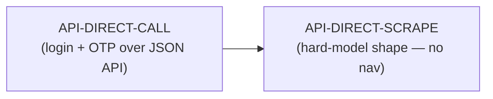

# Pipeline architecture

The pipeline is a **declarative chain of typed phases** orchestrated by `PipelineExecutor`. Each phase implements `BasePhase` and owns four sub-step hooks: `pre`, `action`, `post`, `final`. The executor drives them in order, threading an immutable `IPipelineContext` snapshot between phases.

## The phase chain

Every registered bank runs the **API-direct** pipeline: `API-DIRECT-CALL`
(login + OTP over the bank's JSON API) followed by `API-DIRECT-SCRAPE`.
The library opens no browser; the navigation and DOM-scrape phases that
preceded v10 have been removed.

`IBuilderState` is the internal assembly contract for the configured login and
scrape slots; consumers configure banks through `createScraper`, not this type.
`IContextTracker` is the reducer's internal execution state. It retains the
latest context so the executor disposes the API mediator even when a phase
throws; it is not an extension point for a caller-managed browser.



| Phase                                               | Owner concern                                                                                                                                         |
| --------------------------------------------------- | ----------------------------------------------------------------------------------------------------------------------------------------------------- |
| [API-DIRECT-CALL](../phases/api-direct-call.md)     | Login + OTP over the bank's JSON API                                                                                                                  |
| [API-DIRECT-SCRAPE](../phases/api-direct-scrape.md) | Walk the bank's typed hard-model shape (accounts + balances + transactions) over direct REST/GraphQL — no nav; `.final` emits `ctx.balanceResolution` |

## The Procedure result pattern

The executor returns the first failed phase without replaying it.
Authentication and OTP submissions have side effects. Transport-level
connection retry and coverage backfill have separate, explicit policies.

Every action returns `Procedure<T> = { success: true, value: T } | { success: false, errorType, errorMessage }`. Phases never throw exceptions across boundaries; they return Procedures and the executor consults `.success` to decide whether to advance.

```typescript
type Procedure<T> =
  | { readonly success: true; readonly value: T }
  | {
      readonly success: false;
      readonly errorType: ScraperErrorTypes;
      readonly errorMessage: string;
    };
```

| Helper            | Use                                                         |
| ----------------- | ----------------------------------------------------------- |
| `succeed(value)`  | Build the success branch                                    |
| `fail(type, msg)` | Build the failure branch                                    |
| `isOk(p)`         | Boolean type-guard                                          |
| `toLegacy(p)`     | Convert to the public `IScraperScrapingResult` shape        |
| `assertOk(p)`     | Test-only — `expect(p.success).toBe(true)` + type narrowing |

See [`Procedure.ts`](https://github.com/sergienko4/israeli-bank-scrapers/blob/{{BRANCH}}/src/Scrapers/Pipeline/Types/Procedure.ts).

## Shape callbacks and the guarded boundary

An api-direct shape may reject a payload by throwing when it cannot build a truthful value. [`ShapeGuard.ts`](https://github.com/sergienko4/israeli-bank-scrapers/blob/{{BRANCH}}/src/Scrapers/Pipeline/Phases/ApiDirectScrape/ShapeGuard.ts) is the one place that converts such a throw into the phase's result contract: `guardShape` wraps a value-returning callback, `guardShapeProcedure` wraps one that already returns a `Procedure`, and both answer `Generic` with `shape <callback> threw: <message>`.

The guard covers the seven callbacks that read a payload or decide the walk: `extractAccounts`, `balance.isAbsent`, `balance.extract`, `transactions.extractPage`, `transactions.stop`, `transactions.validatePlan` and `bootstrap.extractPatch`. An escaping exception there would bypass `runScrapeWithRecovery`, so a warm session that served an unusable account list, balance, page, bootstrap patch, stop rule or request-plan guard would abort the run instead of re-logging in and retrying once.

The dispatch-argument builders (`accountNumberOf`, the `buildVars` family, URL and header producers) run earlier, while a request is being assembled, and stay outside the guard: they cannot answer with a `Procedure` without reshaping dispatch, and a throw there is a programming error rather than an unusable response.

The seven are not every callback that sees a response. The rest fall into three groups:

- **Contained at the call site.** `countDiscovered` runs inside its own `try`/`catch` in the exclusion report. A throw becomes a warning that names the counter by type, never by message, and the scrape carries on.
- **Guarded without the message.** `checkBody`, `checkBodyByOperation` (the secondary identity check included) and `responseSession.patch` (on data calls and on bootstrap calls) run through `guardAnswerCallback`. A throw becomes a `Generic` failure naming the callback and the error class, for example `shape checkBody threw: Error`. The thrown message is never carried, because a parse error can quote the bank's answer, and a thrown name outside the platform and library error classes is reported as `Error`. The converted failure is a plain `Generic` one, so `shouldRecoverSession` treats it as any ordinary failure: in per-request mode a warm session recovers once and a cold session never does, and under whole-scrape recovery only a 401/403 recovers, so a throw there stands. It is never an edge (WAF) or integrity refusal, which never recover. A callback's own typed failure keeps its type, so those refusals still never recover. A patch that throws commits nothing to the session.
- **No guard at the call site.** `auditOwnsRow` and `auditIsTxnRow` (the coverage audit) and `resultGuard` (the POST stage, after the scrape has returned) have no `try`/`catch` where they are called. They are left unguarded on purpose: each only observes a response, so a throw is a defect in the shape rather than an unusable answer. A throw from either audit predicate rejects the scrape and skips recovery, and a throw from `resultGuard` propagates out of the POST stage, so in both cases only the executor's catch contains it. `ApiDirectScrapeUnguardedCallbacks.test.ts` pins this and proves each callback is reached.

## IPipelineContext — the shared state slot table

`IPipelineContext` is a discriminated record of `Option<T>` slots. Each phase reads the slots its `pre`/`action`/`post`/`final` declare, and writes only the slots it owns. The compiler enforces that no phase writes outside its declared scope.

Key slots:

| Slot                | Owner                    | Purpose                                                                                                                                                                                                                                                                                                       |
| ------------------- | ------------------------ | ------------------------------------------------------------------------------------------------------------------------------------------------------------------------------------------------------------------------------------------------------------------------------------------------------------- |
| `durableAuth`       | API-DIRECT-CALL.action   | `IDurableAuthState` — the long-lived re-login artifact feeding `result.persistentOtpToken`                                                                                                                                                                                                                    |
| `apiMediator`       | transport context wiring | Authenticated `ApiMediator`, wired at context build by `resolveApiMediator`, whose ordered transport rules pick `createMtlsHeadlessApiMediator` (client cert / TLS profile) or `createHeadlessApiMediator` (`nativeFetch`), and fail closed when a block declares neither, then consumed by `API-DIRECT-CALL` |
| `scrape`            | API-DIRECT-SCRAPE.post   | `accounts`, `accountIdentities` produced by the hard-model shape                                                                                                                                                                                                                                              |
| `balanceResolution` | API-DIRECT-SCRAPE.final  | Final `Map<accountNumber, number>` → `PipelineResult`                                                                                                                                                                                                                                                         |
| `windowEnd`         | Coverage backfill        | Optional internal upper bound for an older requested slice                                                                                                                                                                                                                                                    |
| `diagnostics`       | Shared context           | Per-run diagnostic state                                                                                                                                                                                                                                                                                      |

> Every pipeline bank follows the same `apiMediator` → `scrape` → `balanceResolution` slot sequence; the transport context wiring mints the mediator and `API-DIRECT-CALL` consumes it.

`balanceResolution` is the single source of truth read by [`PipelineResult.combineWithBalance`](https://github.com/sergienko4/israeli-bank-scrapers/blob/{{BRANCH}}/src/Scrapers/Pipeline/Core/PipelineResult.ts).

<a id="headless-transports"></a>

## HTTP transports

An api-direct bank's `transport` config block (`ITransportConfig` on `IPipelineBankConfig.transport`) picks the transport its identity calls run over. [`ApiMediatorWiring.ts`](https://github.com/sergienko4/israeli-bank-scrapers/blob/{{BRANCH}}/src/Scrapers/Pipeline/Core/ApiMediatorWiring.ts) decodes the block into an `IApiWiring` (URLs plus the `IWiringFlags` booleans) and applies the rules in [`HeadlessTransportRules.ts`](https://github.com/sergienko4/israeli-bank-scrapers/blob/{{BRANCH}}/src/Scrapers/Pipeline/Core/HeadlessTransportRules.ts) in order; the first match wins:

| Order | Config                                                 | Kind       | Transport                                                       | Factory                         |
| ----- | ------------------------------------------------------ | ---------- | --------------------------------------------------------------- | ------------------------------- |
| 1     | `requiresClientCert`, `clientCert` and/or `tlsProfile` | `node-tls` | `node:https` (client cert / dynamic cert / ClientHello profile) | `createMtlsHeadlessApiMediator` |
| 2     | `nativeFetch: true`                                    | `native`   | Node's own `fetch`                                              | `createHeadlessApiMediator`     |

A block that declares more than one of `requiresClientCert`/`clientCert`/
`tlsProfile` and `nativeFetch` fails with a `ScraperError` before a transport
kind is returned or a mediator is built. A block that declares none of them
fails the same way (`Missing headless transport`): there is no default
transport, so a bank can never reach the network over an unintended one.
`assertSingleTransport` enforces both; `pickTransportKind` walks the table above.

`resolveTransportKind(companyId)` returns the kind these rules pick
without building a mediator. The public options contract carries no
page-engine settings and no separate warning path.

| Symbol                 | Module                 | Role                                                             |
| ---------------------- | ---------------------- | ---------------------------------------------------------------- |
| `TransportKind`        | `ApiWiringTypes.ts`    | The `Kind` column above — the rule a `transport` block matches   |
| `resolveTransportKind` | `ApiMediatorWiring.ts` | The kind for a bank, or `false` when it has no `transport` block |

The native transport is [`NativeFetchStrategy`](https://github.com/sergienko4/israeli-bank-scrapers/blob/{{BRANCH}}/src/Scrapers/Pipeline/Strategy/Fetch/NativeFetchStrategy.ts). The API-mediator factory installs the capped request seam through constructor options, so the class carries no transport-policy subclass:

- Every request, including any required body read, is capped at the `timeoutMs` option the factory sets to the shared 30 s `NETWORK_FETCH_TIMEOUT_MS`. A hung socket fails as `Timeout` with `"<VERB> <url> network error: timeout"`; any other rejection keeps the inherited `toNetworkFailure` message.
- A request whose TCP connect times out (`UND_ERR_CONNECT_TIMEOUT`, detected by `isConnectTimeout`) is retried by `retryOnConnectTimeout` on a fresh connection, up to `NETWORK_CONNECT_RETRIES` times, each attempt with its own `timeoutMs` budget. Only a single-hop request is repeated (`redirect: 'manual'`, which the `reject` and manual redirect policies send): a connect timeout on such a request never reaches the server, so the retry cannot repeat an OTP or a payment, and a manual redirect replays only the hop that failed, never the original POST. Under `follow` fetch walks redirects itself, so the timeout may come from a later hop after the POST was already processed; that request is never repeated. The edge in front of some banks silently drops a share of new connections, so a bank whose POSTs need this retry sets `transport.redirectPolicy: 'reject'` (Pepper and PayBox do). Resets, DNS failures and aborts are not retried. Whatever failure remains reports its cause code, read by `errorCauseCodeOf` only when it is a well-formed uppercase identifier, for example `"<VERB> <url> network error: fetch failed (UND_ERR_CONNECT_TIMEOUT)"`.
- A native bank may set `transport.isConnectRetryDisabled: true` to stop after the first connection timeout even on a manual hop. Banks that do not opt out retain the default.
- A GET sends no default `content-type`; a POST still sends `application/json`. The factory passes `CAPPED_DEFAULT_HEADERS` as the strategy's `DefaultHeadersByVerb` option; the base strategy sends JSON on both verbs. A caller `Content-Type` in any letter case replaces the default, since `fetch` would otherwise join both values into one.
- GraphQL passes `capOnlyWithIntegrity: true`: an operation that names no integrity policy keeps the uncapped base transport, exactly as before.

`INativeFetchOptions` gives native REST and GraphQL strategies the same bank-wide
redirect/status defaults, HTTP-failure body omission, per-request cap and default
verb headers. `TRequest` and `IDispatch` are internal extension
contracts: a request becomes a dispatch with its own response-reading policy,
so concurrent calls do not overwrite each other's policy.

The capped transport is split into internal seams so no module outgrows the file
cap: `CappedBody.ts` exports `fetchWithinCap` and its `ICappedRequest` input
(connect and required-body reads under one ceiling), `CappedInvoke.ts` binds that
seam to `makeInvokeCapped`, `NativeFetchDispatch.ts` exports `dispatchFetch`
(redirect policy, cookie/header hooks and response routing), and
`NativeFetchNetwork.ts` exports `INVOKE_NATIVE_FETCH`, `invokeFetch`,
`refuseBody` and `toNetworkFailure` for the raw `globalThis.fetch` call. The
API-mediator factories share the `IApiMediatorArgs` bundle and return the
`IApiMediatorStrategies` pair; both are internal wiring types, not user-facing
configuration.
REST and GraphQL calls both honor `IApiQueryOpts.policy`: per-call redirect
settings override the bank default, and header sinks receive only declared headers.

With `transport.omitBankText: true`, native HTTP failures keep their verb, safe URL
and status, but replace the response snippet with `response body omitted`.
`classifyHttpFailure` still examines the body for WAF classification first;
fixed WAF reasons and error types are unchanged. Without this opt-in, generic
failures retain their existing snippets.

A bank whose session is a cookie, not an auth header, sets `sessionCookies: true`. Both node factories then pass their transport through `withCookieSession`; without `cookieDomains` it calls `withSessionCookies`, which wraps it in [`SessionCookieFetchStrategy`](https://github.com/sergienko4/israeli-bank-scrapers/blob/{{BRANCH}}/src/Scrapers/Pipeline/Strategy/Fetch/SessionCookieFetchStrategy.ts): one run-scoped `IOriginCookieJar` (built by `createOriginCookieJar`) that keeps one `ICookieJar` (built by `createSimpleCookieJar`) per origin. Every response's `Set-Cookie` feeds the jar of the origin that answered — the response's final URL when `fetch` followed a redirect, else the request URL — and every POST and GET sends only its own origin's cookies as one `cookie` header, replacing a caller cookie header in any letter case, since `fetch` would otherwise send both values. Under the default `follow` redirect policy `fetch` follows redirects itself, so a redirect hop's own `Set-Cookie` lines never reach the jar; a `manual` policy files them (see [Redirect policies](#redirect-policies)). The origin comes from the `FullyQualifiedUrl` the transport itself resolves (`resolveFetchUrl`: relative paths join the base URL), so a cookie never goes back to a different host, scheme or port, a `Domain` attribute never widens it, and a URL that cannot be parsed neither sends nor keeps a cookie. A later cookie of the same name replaces the earlier one; `Max-Age=0` (or less), or an `Expires` already past, deletes it (`Max-Age` wins when both are set); an empty jar adds no header; a caller's own `onSetCookie` hook still runs; cookie values are never logged. Without the flag the transport is returned unchanged.

A bank whose login hops across sibling hosts of one registrable domain also sets `cookieDomains` (for example `['bank.example']`). `withCookieSession` then builds the decorator over the RFC 6265 jar from [`createDomainCookieJar`](https://github.com/sergienko4/israeli-bank-scrapers/blob/{{BRANCH}}/src/Scrapers/Pipeline/Strategy/Fetch/DomainCookieJar.ts) instead of the origin jar, and returns an `ISessionTransport`: the decorated transport plus its `ICookieSession`, which the factory attaches to the mediator as `cookies` (the token bus a login flow sees; banks without `cookieDomains` get `cookies === undefined`).

- `parseSetCookie` (`SetCookieScope.ts`) turns one `Set-Cookie` line into an `IStoredCookie` (name, value, domain, path, `hostOnly`, `secure`, `expiresEpochS`, where `SESSION_EXPIRY` 0 marks a session cookie). It reuses the simple jar's `parseCookieLine`, `readAttribute` and `MAX_AGE_RE`. A `Domain` is kept only when it is in `cookieDomains` and the answering host `domainMatches` it; a `Domain` equal to a non-listed host stays host-only; any other `Domain` drops the cookie, so the allow-list stands in for a public-suffix list. The jar consults no public-suffix list, so `cookieDomains` is reviewed first-party config: it lists only the bank's own registrable domains, never a public suffix such as `co.il`. A missing or relative `Path` takes the `defaultPath` of the request. `Max-Age` beats `Expires`, and a past expiry deletes the stored cookie. An attribute is named by its text before any `=`, so `Secure=true` marks the cookie `Secure`.
- `IDomainCookieJar` keys cookies by name + domain + path: a new cookie replaces a live stored cookie with that key in place (keeping its creation order), whether it is host-only or a domain cookie. Recreating an expired key gets a new creation order. `targetOf` resolves a request URL into an `ICookieTarget` (host, path, scheme) the way the transport resolves it; `cookieApplies` sends a cookie only when the host matches, the path matches on a `/` boundary, it has not expired (`isExpired` against `nowEpochS`) and, if `Secure`, the URL is https. Matching cookies go out longer path first, then in creation order. An unparseable URL neither keeps nor sends a cookie.
- `ICookieSession` is the narrow port onto that same jar: `cookieFor(url, name)` reads one applicable value, `headerFor(url)` returns the header the transport would send, `set(url, cookie)` stores an `IClientCookie` host-only to the URL's host (default path `/`, `Secure`, session lifetime), `exportAll()` lists unexpired cookies, `importAll(list)` replaces the whole jar, and `clear()` empties it. Every way into the jar refuses a cookie that cannot travel as `name=value` in a `cookie` header (an empty name, `=` in the name, `;` or a byte outside the field-value set in either part: `isSendableCookie` in `HeaderText.ts`) or whose path does not start with `/`, and `importAll` also refuses a domain cookie whose domain is not in `cookieDomains`. Cookie values are never logged.
- A request header whose value is the sentinel `@cookie:<name>` (`COOKIE_HEADER_SENTINEL_PREFIX` in [`CookieHeaderSentinel.ts`](https://github.com/sergienko4/israeli-bank-scrapers/blob/{{BRANCH}}/src/Scrapers/Pipeline/Strategy/Fetch/CookieHeaderSentinel.ts)) echoes a cookie, as an anti-replay `X-XSRF-TOKEN` does. `substituteCookieHeadersBy` resolves every sentinel through the transport's `ICookieReader`: a `CookieLookup` that reads one stored value by name, and the `CookieDecode` (`loose`) a `@cookie:` value goes through. Over a domain jar the session decorator builds the lookup on `cookieFor(url, name)` and decodes with `decodeCookieLenient` ([`CookieValueDecode.ts`](https://github.com/sergienko4/israeli-bank-scrapers/blob/{{BRANCH}}/src/Scrapers/Pipeline/Strategy/Fetch/CookieValueDecode.ts)): the value is URI-decoded, and a malformed escape, or a decoded value `isHeaderSafe` refuses as a field value, is sent raw.
- `@cookie-strict:<name>` (`STRICT_COOKIE_HEADER_SENTINEL_PREFIX`) decodes with `decodeCookieStrict` on both transports: a value that does not decode fails `Generic` with `"cookie <name> undecodable"`, naming the cookie only, never its value.
- A `?<fallback>` after the name (the name ends at the first `?`, which no cookie name holds) is sent verbatim, never decoded and possibly empty, when the cookie is missing or its value is empty: `@cookie:tuuid?` sends `''`. Without one, the header is dropped when no cookie of that name applies to the request URL (over a domain jar, under its domain and path rules), and an empty cookie is sent empty.
- Resolution returns a `Procedure`, so a header that cannot be resolved stops the request before the inner transport is called or the page fetch starts. The decorator builds its headers in [`SessionCookieHeaders.ts`](https://github.com/sergienko4/israeli-bank-scrapers/blob/{{BRANCH}}/src/Scrapers/Pipeline/Strategy/Fetch/SessionCookieHeaders.ts): `jarHeaders` resolves the sentinels against the `ISessionJar`, then adds the `cookie` header; `sentinelHeaders` picks out the caller's sentinel headers of either kind with `cookieSentinelHeaders` (none over an origin jar); and `sessionHeaders` rebuilds both for every manual redirect hop (see [Redirect policies](#redirect-policies)), so a cookie a redirect sets is checked before the next hop. The `cookie` header itself keeps the stored, undecoded values. An origin jar leaves header values unchanged.

`exportAll()` returns detached records, and `importAll(list)` copies accepted
records, so mutations outside the cookie-session port cannot change the live jar.

### Dynamic client certificate

A bank whose login obtains its device certificate at runtime (the flow builds a CSR and the bank issues the certificate) declares `clientCert: { mode: 'dynamic', origin }` on its transport block: an `IDynamicClientCert` from [`ClientCertControl.ts`](https://github.com/sergienko4/israeli-bank-scrapers/blob/{{BRANCH}}/src/Scrapers/Pipeline/Types/Domain/ClientCertControl.ts), whose `origin` is the exact https origin the certificate is presented to. The block then runs over `node-tls`, and `createMtlsHeadlessApiMediator` builds the agent source its two transports share with `buildTransportSource` ([`ApiMediator.nodeTransport.ts`](https://github.com/sergienko4/israeli-bank-scrapers/blob/{{BRANCH}}/src/Scrapers/Pipeline/Mediator/Api/ApiMediator.nodeTransport.ts)):

- `createClientCertHolder(origin, buildAgent)` ([`ClientCertHolder.ts`](https://github.com/sergienko4/israeli-bank-scrapers/blob/{{BRANCH}}/src/Scrapers/Pipeline/Strategy/Fetch/Mtls/ClientCertHolder.ts)) returns an `IClientCertHolder`: the per-request `AgentSource` and the `IClientCertControl` port, which the factory attaches to the mediator as `clientCert` (on the token bus a login flow sees; every other bank has `clientCert === undefined`). A login step installs through it with its own `clientCert` field ([Device certificate](../phases/api-direct-call/signing.md#device-certificate)). Its `AgentBuilder` carries the bank's `tlsProfile` and the server-certificate floor.
- `install(pair)` takes an `IClientCertPair` (PEM key, PEM certificate). A pair that does not parse, or whose certificate does not certify its key, fails `Generic` with `"client certificate invalid"` and the previous certificate stays. Otherwise the holder builds an agent presenting the pair, swaps it in and destroys the agent it replaced. `clear()` drops the certificate and destroys its agent. The pair lives only in memory for the run and is never logged or written.
- `makeMtlsInvoke` asks the source on every request and gets an `IAgentChoice` (the agent and the `IPresentedCert` it presents). A request whose `URL.origin` equals the declared origin goes through the installed agent; any other origin, and every request before an install or after a clear, goes through a plain agent that presents no certificate.
- The `node:https` transport does not follow redirects automatically: a 3xx under its default `follow` is an HTTP failure. A step may explicitly `reject` redirects; manual redirects require a native-fetch-only bank default, so node-tls cannot enable them. The dynamic certificate is presented only to its declared origin.
- A bank with a registered certificate (`requiresClientCert`) or none keeps one shared agent behind `fixedAgentSource` ([`MtlsAgentSource.ts`](https://github.com/sergienko4/israeli-bank-scrapers/blob/{{BRANCH}}/src/Scrapers/Pipeline/Strategy/Fetch/Mtls/MtlsAgentSource.ts)); `presentedOf` names the certificate it presents.
- The E2E-mocked seam `setMtlsFetchFallback` takes an `MtlsFallback`, called with one `IMtlsFallbackRequest` (URL, init, verb and `presented`: the certificate's SHA-256, or `false` for none), so a mocked suite can prove which requests would carry the certificate without a handshake.

### Redirect policies

The native transport sends every request under a `RedirectPolicy` ([`FetchPolicy.ts`](https://github.com/sergienko4/israeli-bank-scrapers/blob/{{BRANCH}}/src/Scrapers/Pipeline/Types/Domain/FetchPolicy.ts)). The bank-wide default is `transport.redirectPolicy` (absent: `follow`), which the factory hands to `NativeFetchStrategy` as its `redirectPolicy` option; one api-direct step overrides it with its own `redirect` field, carried down as an `IFetchCallPolicy` (`IApiQueryOpts.policy`, which `IFetchOpts` extends). node:https honors a step's `reject` but not the bank-wide default.

| Policy                                             | Sends                | On a 3xx                                                                                    |
| -------------------------------------------------- | -------------------- | ------------------------------------------------------------------------------------------- |
| `follow`                                           | the request as-is    | `fetch` follows it; the final response comes back with its own URL                          |
| `reject`                                           | `redirect: 'manual'` | fails `Generic` with `"<VERB> <url> HTTP <status> redirect refused"`                        |
| `IManualRedirect` `{ maxHops, allow, postAsGet? }` | `redirect: 'manual'` | follows the statuses below itself, up to `maxHops`, only to a target an `allow` rule admits |

`reject` still applies the refused response's `Set-Cookie` updates and calls
the caller's cookie hook once, under the answering URL, without following the redirect.
`isRedirectStatus` supplies the shared 3xx boundary for redirect handling
and the capped transport. Under `reject` or `manual`, the cap releases those
bodies at headers instead of buffering them, so a stalled body cannot delay
the refusal, cookie updates or the next allowed hop.

[`sendUnderPolicy`](https://github.com/sergienko4/israeli-bank-scrapers/blob/{{BRANCH}}/src/Scrapers/Pipeline/Strategy/Fetch/RedirectFollow.ts) runs one `IRedirectRun` (URL, init, verb, the transport's `FetchInvoke` sender and its `HttpVerb`, the `onSetCookie` hook and an optional `sessionHeadersFor`) and returns an `IRunEnd`: the final response and the URL its cookies belong to. Under `manual`:

- [`followedAfter`](https://github.com/sergienko4/israeli-bank-scrapers/blob/{{BRANCH}}/src/Scrapers/Pipeline/Strategy/Fetch/RedirectHopRules.ts) picks the statuses by the verb of the request that drew the redirect: 301/302/303/307/308 after a GET; after a POST, 302/303 when the policy names `postAsGet` (from `postStatusesOf`) and none otherwise, so a 301/307/308 to a POST is always refused.
- Each hop is a body-less GET sent with `redirect: 'manual'` through the same sender, so every hop keeps the 30 s cap. Its headers start from the previous hop's. Every header the session owns (`ISessionHeaders.owned`: `cookie` and each `@cookie:` or `@cookie-strict:` header, lower-cased) is replaced by the session's `values` for the hop URL, from `sessionHeadersFor(hopUrl)`. The session decorator computes them from its jar, so each hop carries only the cookies and echoed cookie values that apply to it. When `sessionHeadersFor` fails, that failure ends the run before the hop is sent; the redirect's own `Set-Cookie` lines are already filed. Once any hop changes origin, `authorization` and `proxy-authorization` are dropped after the session's values are added, as the Fetch standard requires, so neither the caller's nor a session-owned one is sent on that hop or any later one, even a later same-origin hop. Without a session, `cookie` alone is replaced (dropped). The GET hop after a POST also drops the request-body headers (`content-type`, `content-encoding`, `content-language`, `content-location`), as the Fetch standard does when it turns a POST into a GET. `droppedOnHop` names both sets; `hopHeaders` applies replacement before dropping them.
- `emitSetCookies` hands each redirect's `Set-Cookie` lines to the hook under that hop's URL (the request URL when the response has none) before the next hop is built, so a cookie set on one hop goes out on the next.
- A relative `Location` resolves against the hop URL. [`matchesAnyUrlRule`](https://github.com/sergienko4/israeli-bank-scrapers/blob/{{BRANCH}}/src/Scrapers/Pipeline/Strategy/Fetch/UrlRule.ts) admits a target only when it is clean https (no userinfo, no fragment), its `URL.origin` equals an `IUrlRule`'s `origin`, and the rule's path terms hold. An exact-path rule (`IExactPathRule`) needs a path that is one of its `paths` and a query that holds its `query` pairs once each (with `exactQuery`, nothing else). An any-path rule (`IAnyPathExceptRule`) admits any path and query whose lower-cased path contains none of its `anyPathExcept` texts, compared case-insensitively.
- A missing or unparseable `Location`, a 300 or 304, a refused target or a hop past `maxHops` fails `Generic` with `"<VERB> <url> redirect refused"`, naming only the first request's log-safe URL; the `Location` is never logged. A hop's transport failure comes back unchanged.
- An api-direct config names a manual policy only in a step's `redirect`: a GET step's, or a POST step's with `postAsGet: true`. The [build-time config checks](../phases/api-direct-call/checks.md#build-time-config-checks) refuse it as the bank default, on a POST step without `postAsGet` or with `postAsGet` on a GET step, refuse an empty `allow` or a `maxHops` outside 1–10, and require the bank default `reject` beside it.

### Document responses and status policies

Once a response answers, the native transport wraps it in an `IAnswer` (response, verb, URL and the `IResponseReading` built from the bank's status policy plus the call's `responseKind`, `documentMarker`, `mediaType` and `strictUtf8`) and routes it in a fixed order, so a bank without a policy reads its answers exactly as before:

1. A bank may explicitly mark a status `rate-limit` in `transport.statusPolicy`. [`applyRateLimit`](https://github.com/sergienko4/israeli-bank-scrapers/blob/{{BRANCH}}/src/Scrapers/Pipeline/Strategy/Fetch/StatusPolicy.ts) reports `WafBlocked` with the safe URL and status without reading the response body. Other non-2xx answers, and other answers carrying Cloudflare's challenge header, go to the WAF classifier. A block page or challenge on a document step is still a `WafBlocked` failure, never `{}`.
2. [`applyStatusPolicy`](https://github.com/sergienko4/israeli-bank-scrapers/blob/{{BRANCH}}/src/Scrapers/Pipeline/Strategy/Fetch/StatusPolicy.ts) then checks the bank's remaining `transport.statusPolicy` (a `StatusPolicy`, handed to `NativeFetchStrategy` as its `statusPolicy` option). Before the body is read, the `StatusAction` `empty` answers `{}` (`emptyAnswer`) and `fail` fails `Generic` with `"<VERB> <url> HTTP <status>"`. A document step skips `empty`, so a 204 reaches the document reader as an empty page.
3. [`refuseMediaType`](https://github.com/sergienko4/israeli-bank-scrapers/blob/{{BRANCH}}/src/Scrapers/Pipeline/Strategy/Fetch/MediaTypeCheck.ts) then checks the answer's media type, when the call expects one: the call's own `mediaType`, else the bank's `transport.mediaTypes` default for the call's response kind (a `MediaTypePolicy`, handed to `NativeFetchStrategy` as its `mediaTypes` option and kept on the `_mediaTypes` seam). The answer's media type is its `content-type` before any `;`, trimmed and lower-cased, and must equal the expected one exactly; a missing or different type fails `Generic` with `"<VERB> <url> unexpected media type"` (`MEDIA_TYPE_REFUSED_REASON`), naming no header value. A call that expects none is read as before.
4. The reader the call's `responseKind` names reads the body, each through [`readBodyText`](https://github.com/sergienko4/israeli-bank-scrapers/blob/{{BRANCH}}/src/Scrapers/Pipeline/Strategy/Fetch/BodyText.ts): when the call's `strictUtf8` — else the bank's `transport.strictUtf8`, handed to `NativeFetchStrategy` as its `strictUtf8` option and kept on the `_strictUtf8` seam — is true, it decodes the bytes as UTF-8 with `fatal`, so a malformed byte fails `Generic` with `"<VERB> <url> body not utf-8"` (`BODY_NOT_UTF8_REASON`), naming no body, instead of becoming U+FFFD; otherwise it reads them as `text()` does. Both drop a leading BOM. `json` (the default) parses it as before, so HTML on a json step is still a parse error. `document` ([`readDocument`](https://github.com/sergienko4/israeli-bank-scrapers/blob/{{BRANCH}}/src/Scrapers/Pipeline/Strategy/Fetch/DocumentResponse.ts)) reads it as text, checks it for the call's `documentMarker` when one is set (otherwise it fails `Generic` with `"<VERB> <url> document unverified"`), and answers `{}`. `text` ([`readText`](https://github.com/sergienko4/israeli-bank-scrapers/blob/{{BRANCH}}/src/Scrapers/Pipeline/Strategy/Fetch/TextResponse.ts)) reads it as text and answers `{ text }`, so a step's extracts read it at `/text`; an answer over the call's `maxTextChars` (65 536 chars by default) fails `Generic` with `"<VERB> <url> text too long"`. The fixed tails `DOCUMENT_UNVERIFIED_REASON`, `TEXT_TOO_LONG_REASON`, `MEDIA_TYPE_REFUSED_REASON`, `BODY_NOT_UTF8_REASON` and `REDIRECT_REFUSED_REASON` live in `FetchPolicy.ts`, shared by the transport and the step sanitiser.

For JSON answers, `parseJsonResponse` reads with the call's UTF-8 policy before
parsing, so malformed bytes fail as a decoding error instead of a JSON error.
Rejected body reads fail `Generic` with `"<VERB> <url> body read failed"`,
without exposing rejection details.

The `FetchInvoke` seam carries an `IFetchInvokePolicy` with the verb and
expected media type through each redirect hop. The node:https transport
checks API-success headers before collecting the body: a mismatch closes
the stream and returns its headers to the shared router, preserving cookies,
WAF classification and status-policy precedence without waiting for a body.
The native REST and GraphQL transports share the bank's media-type and strict
UTF-8 defaults; a call's own policy still wins. The node:https transport
retains raw response bytes through `collectBody` and `toResponse`; otherwise
an earlier lossy decode would hide malformed bytes from the later strict
reader.

`isApiSuccess`, `statusActionFor` and `isMediaTypeMismatch` are shared by response
routing and the capped HTTP transport. When the status or media-type policy
decides from headers, only that request's body is cancelled; undecided,
challenged and document-empty responses still need a body read under the cap.
A per-query empty-status notification preserves an approved GraphQL empty
result without accepting a parsed `{}` as a valid GraphQL envelope or sharing
the verdict with another query.

[`cancelResponseBody`](https://github.com/sergienko4/israeli-bank-scrapers/blob/{{BRANCH}}/src/Scrapers/Pipeline/Strategy/Fetch/ResponseBody.ts)
releases bodies discarded by status decisions or redirect handling, including
uncapped GraphQL responses. Cancellation failures retain the policy verdict
and emit a warning containing only the verb, log-safe URL and a fixed message;
neither response content nor cancellation error text is logged. Responses
left to a reader, including document-marker and WAF checks, remain untouched.

An api-direct step opts in with `response: 'document'` and an optional
`documentMarker` (it names no body extracts — a build-time check), or with
`response: 'text'` and an optional `maxTextChars`; `callPolicyOf` carries them
down as `IFetchCallPolicy.responseKind` / `documentMarker` / `maxTextChars`,
next to `redirect`, with a step's `mediaType` and `strictUtf8` as
`IFetchCallPolicy.mediaType` / `strictUtf8`.
The step-level sanitiser keeps these refusals' fixed tails (`bind HTTP 207`,
`bind HTTP 302 redirect refused`, `bind document unverified`,
`bind unexpected media type`, `bind body not utf-8`) only when the whole
message has a policy refusal's shape, so no response text can pass for one.

### Response-header carry

A step can carry values the bank returns in response headers. `headerExtractsToCarry` maps a carry slot to an `IHeaderExtract`: a `header` name, compared case-insensitively, and an optional `fallback`. [`attachHeaderCapture`](https://github.com/sergienko4/israeli-bank-scrapers/blob/{{BRANCH}}/src/Scrapers/Pipeline/Mediator/ApiDirectCall/Flow/Steps/RunStep.headerCarry.ts) builds the step's `IHeaderCapture`. Its `IResponseHeaderSink` (the lower-case header `names` and a `take` receiver, handed each answer's declared headers, its HTTP status and the URL that gave it) rides down as `IFetchCallPolicy.headerSink`, next to `redirect`. The map that sink fills stays on the step's fire args and never reaches the bus.

The native transport hands the final response to [`emitResponseHeaders`](https://github.com/sergienko4/israeli-bank-scrapers/blob/{{BRANCH}}/src/Scrapers/Pipeline/Strategy/Fetch/ResponseHeaderSink.ts), next to the Set-Cookie hook. `emitResponseHeaders` passes the sink only the declared headers the response carried. Each `take` replaces what the sink held, so when a call is retried after a 401 only the last answer's headers and URL count. A step that names `finalUrlInto` gets the same capture, with no declared headers if it reads none, and carries that URL — see [Final URL carry](../phases/api-direct-call/flow.md#final-url-carry). After the outcome is judged and the required extracts are read, `carryHeaders` fills each slot from its header, else from its `fallback`, else fails the step `Generic` with `"<step> header missing"`. Optional extracts are read after the header slots. The TLS transport ignores the sink, so a declared header slot on them fails closed. Header values are never logged.

### Form bodies

A POST step sends JSON unless it names another `BodyEncoding`: `form`, `form-utf8`, `form-latin1` or `text`. `callPolicyOf` carries the encoding down as `IFetchCallPolicy.bodyEncoding`, next to `redirect` and `responseKind`. [`writePostBody`](https://github.com/sergienko4/israeli-bank-scrapers/blob/{{BRANCH}}/src/Scrapers/Pipeline/Strategy/Fetch/PostBody.ts) then writes the body: `json` as JSON text, `form` as `application/x-www-form-urlencoded` pairs in config order. `form-utf8` writes the same UTF-8 pairs under exactly `application/x-www-form-urlencoded;charset=UTF-8` — no space, as a bank's own client labels them. `form-latin1` writes the same pairs through [`encodeLatin1Form`](https://github.com/sergienko4/israeli-bank-scrapers/blob/{{BRANCH}}/src/Scrapers/Pipeline/Strategy/Fetch/Latin1Form.ts), which encodes like Java's `URLEncoder` over ISO-8859-1 (`A-Z a-z 0-9 . - * _` kept, a space as `+`, every other char as its `%XX` latin1 byte) and sends them under `application/x-www-form-urlencoded; charset=ISO-8859-1`. `text` sends the one string field of a `{ text }` body verbatim. `withBodyContentType` puts the body's content-type in place of any content-type the bank's headers name — or, for `text`, removes it — so a body never travels labelled as something it is not. A call that names no encoding is sent byte for byte as before.

A writer refuses a body it cannot write, before any request, failing `Generic` with `"POST <url> <reason>"`: `form-latin1 unencodable` (`LATIN1_UNENCODABLE_REASON`) when a name or value holds a char above U+00FF, and `text body not a string` (`TEXT_BODY_REFUSED_REASON`) when a `text` body is not exactly one string field named `text`. The step sanitiser keeps both tails, so the step fails `<step> form-latin1 unencodable` or `<step> text body not a string`, naming no value.

A form body (either form encoding, the `FORM_BODY_ENCODINGS`) must be a flat record, or one `$merge` that lays a flat record over a carried form, and a `text` body must be shaped exactly `{ text }`. The build refuses a nested form shape, a loose text shape or a `$merge` anywhere else (`API_DIRECT_FORM_RULES`), and at run time [`guardFormBody`](https://github.com/sergienko4/israeli-bank-scrapers/blob/{{BRANCH}}/src/Scrapers/Pipeline/Mediator/ApiDirectCall/Flow/Steps/RunStep.form.ts) fails the step with `<step> form body not flat` before any request when a `$ref` hydrates to an array, an object, `null` or a non-finite number. The failure names no value. Only the native transports write form bodies, so `encoding` off native fetch fails the build.

### Sealed fields

A step can seal credentials into its body. `seal` names an `ISealFieldConfig`, one config per `SealKind`. [`applySeal`](https://github.com/sergienko4/israeli-bank-scrapers/blob/{{BRANCH}}/src/Scrapers/Pipeline/Mediator/ApiDirectCall/Flow/Signing/RunStep.seal.ts) runs after `cryptoField` and before the AES body signature and `guardFormBody`. It calls [`planSeal`](https://github.com/sergienko4/israeli-bank-scrapers/blob/{{BRANCH}}/src/Scrapers/Pipeline/Mediator/ApiDirectCall/Crypto/SealKinds.ts), which runs the planner `SEAL_PLANNERS` names for the kind. A planner reads its refs (`SealRef`: `creds.*` or `carry.*`) through a `SealRefText` reader over the step scope, so Crypto never imports the template layer. It returns a `SealPlan`: the `ISealedWrite`s, each a sealed value and its body pointer, or a failure. `applySeal` writes each value only at its pointer: neither a credential nor its sealed text is copied into carry.

An `rsa-pkcs1-block-xor` seal (`ISealRsaBlockXorConfig`) names the `sourceRef` credential (`creds.*`), the `modulusRef` carry slot that holds the bank's RSA modulus as hex (`carry.*`), one `writeTo` pointer and its `ISealRsaBlockXorParams`, which the bank config names in full: `exponent`, `seedAlphabet`, `seedLength`, `blockChars`, `prefix`, `blockSeparator` and `envelopeTerminator`. [`sealRsaBlockXor`](https://github.com/sergienko4/israeli-bank-scrapers/blob/{{BRANCH}}/src/Scrapers/Pipeline/Mediator/ApiDirectCall/Crypto/SealRsaBlockXor.ts) draws a fresh seed with `crypto.randomInt`, splits `prefix` + seed into `blockChars` chunks, encrypts each chunk with RSA PKCS#1 v1.5 under the bank's public key, and joins the hex blocks with `blockSeparator`, ending with `envelopeTerminator`. [`sealTail`](https://github.com/sergienko4/israeli-bank-scrapers/blob/{{BRANCH}}/src/Scrapers/Pipeline/Mediator/ApiDirectCall/Crypto/SealTail.ts) XORs each UTF-16 unit of the credential with the cycled seed and percent-encodes the result. The sealed value is the envelope plus the tail as URL-safe base64, padding kept. Its planner hands `sealRsaBlockXor` an `ISealInput` (the credential, the modulus hex and the params). Tests pass `sealRsaBlockXor` a fixed `SeedSource` in place of the random draw.

An `rsa-pkcs1-v15` seal (`ISealRsaPkcs1Config`) names a `keyRef` carry slot and one or more `fields`, each an `ISealedFieldTarget`: a `sourceRef` credential and its own `writeTo`. [`planRsaPkcs1`](https://github.com/sergienko4/israeli-bank-scrapers/blob/{{BRANCH}}/src/Scrapers/Pipeline/Mediator/ApiDirectCall/Crypto/SealRsaPkcs1.ts) imports the key once: a PEM public key, or base64 SPKI DER with whitespace ignored, of type RSA and at most 16,384 characters. `importSealKey` does the import; `sealRsaPkcs1` then encodes each credential as latin1, encrypts it alone with RSA PKCS#1 v1.5 padding and returns the standard base64 ciphertext for that field's pointer. The padding is random, so two seals of one credential differ.

A step fails before any request, naming no value. `<step> seal key invalid`: the key slot is missing; for block-xor, the modulus is not even-length odd hex of 128 to 2048 digits or yields a key under 512 bits; for `rsa-pkcs1-v15`, the text is no RSA public key. `<step> seal source invalid` (`SOURCE_INVALID`): a credential is missing or empty; for block-xor, longer than 256 characters or holding a lone surrogate; for `rsa-pkcs1-v15`, too long for the key. `<step> seal unencodable`: an `rsa-pkcs1-v15` credential holds a character above U+00FF. `<step> seal writeTo invalid`: a pointer does not resolve in the body. The build refuses an unknown kind, a seal off a POST record body, a `writeTo` that is not a JSON pointer, a seal with no field or two fields at one pointer, and block-xor params out of range (`API_DIRECT_SEAL_RULES`).

### Client cookies

A login step can set cookies the bank expects the client to have written, and read cookies the bank set. On a run with a domain jar (`transport.cookieDomains`), [`bindStepCookies`](https://github.com/sergienko4/israeli-bank-scrapers/blob/{{BRANCH}}/src/Scrapers/Pipeline/Mediator/ApiDirectCall/Flow/Steps/RunStep.clientCookies.ts) runs first in every step: it binds a jar view to the step URL before the URL, body or headers resolve. A `cookie.<name>` ref reads through that view: [`resolveCookieRef`](https://github.com/sergienko4/israeli-bank-scrapers/blob/{{BRANCH}}/src/Scrapers/Pipeline/Mediator/ApiDirectCall/Template/CookieRef.ts) takes the raw value of the cookie that applies to the step URL, as a `CookieLookup` returns it, and URL-decodes it. Scrape steps get no jar view, so a `cookie.<name>` ref there misses.

`setCookies` maps cookie names to a `ClientCookieSource`: either a required ref or an `IOptionalClientCookie` (`{ ref, optional: true }`). An optional source that is absent or resolves to empty text is skipped, leaving any stored cookie untouched. Every other source must resolve to a string of 1 to 4096 RFC 6265 cookie-octets before any cookie is written; then each is written host-only with `Path=/` and `Secure`, so it travels on the step's own request and on later requests to that host. Pre-hook cookie previews apply the same optional-write rules before requesting a credential, using `cookieRefOf` to read either source's ref.

A step fails before any request, naming no value: `ref cookie.<name> miss` when no required cookie applies or the run has no domain jar; `ref cookie.<name> bad` when the raw value is over 4096 characters or holds a malformed escape; `<step> setCookies <name> invalid` when a ref does not resolve to cookie-octets; `<step> setCookies needs a cookie session` when the run has no cookie jar. The build refuses `setCookies` without `transport.cookieDomains`, a cookie name that is not an HTTP token, and malformed sources (`API_DIRECT_NATIVE_RULES` and `API_DIRECT_COOKIE_RULES`).

## Source pointers

- [`PipelineAssembly.ts`](https://github.com/sergienko4/israeli-bank-scrapers/blob/{{BRANCH}}/src/Scrapers/Pipeline/Core/Builder/PipelineAssembly.ts) — `PHASE_CHAIN` slot declarations
- [`PipelineExecutor.ts`](https://github.com/sergienko4/israeli-bank-scrapers/blob/{{BRANCH}}/src/Scrapers/Pipeline/Core/Executor/PipelineExecutor.ts) — drives the slots in order
- [`BasePhase.ts`](https://github.com/sergienko4/israeli-bank-scrapers/blob/{{BRANCH}}/src/Scrapers/Pipeline/Phases/Base/BasePhase.ts) — `pre`/`action`/`post`/`final` contract every phase implements
- [`PipelineContextFactory.ts`](https://github.com/sergienko4/israeli-bank-scrapers/blob/{{BRANCH}}/src/Scrapers/Pipeline/Core/PipelineContextFactory.ts) — builds the initial context per run
