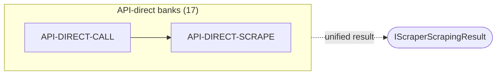

# Israeli Bank Scrapers

Scrape transactions from **17 Israeli banks and credit card companies** through their APIs with **end-to-end PII redaction**.

```sh
npm install @sergienko4/israeli-bank-scrapers
```

[Quick Start :material-rocket-launch:](quick-start.md){ .md-button .md-button--primary }
[Architecture overview :material-sitemap:](architecture/index.md){ .md-button }
[API Reference :material-code-braces:](https://sergienko4.github.io/israeli-bank-scrapers/api/){ .md-button }

---

## Who is this for?

<div class="grid cards" markdown>

- :material-account: **Users** — install the package, pick a `CompanyTypes`, pass credentials, receive transactions. Start at **[Quick Start](quick-start.md)** then jump to **[Banks → your bank](banks/index.md)**.

- :material-developer-board: **Developers** — read **[Architecture → Pipeline](architecture/pipeline.md)** to understand the typed phase chain, then drill into any **[Phase](phases/index.md)** sub-step contract.

- :material-shield-check: **Maintainers** — **[Workflow → CI gates](workflow/ci.md)** and **[Workflow → Pre-commit](workflow/pre-commit.md)** explain every gate. **[Observability](observability/index.md)** documents the structured events and redaction policy.

- :material-bank-plus: **Adding a bank?** — **[Contributing → Adding a new bank](contributing/new-bank.md)** is a step-by-step from `CompanyTypes` entry to declarative `PipelineBuilder`.

</div>

## At a glance



| Surface          | Counts                                            | Source of truth                                 |
| ---------------- | ------------------------------------------------- | ----------------------------------------------- |
| Banks supported  | **17** total — all API-direct on the Pipeline     | [Banks](banks/index.md)                         |
| Phases           | API-direct: `API-DIRECT-CALL → API-DIRECT-SCRAPE` | [Phases](phases/index.md)                       |
| Test suites      | 412, ~4,800 tests, 97.20% statements coverage     | [Workflow → CI gates](workflow/ci.md)           |
| Pre-commit gates | Up to 23 gates in parallel                        | [Workflow → Pre-commit](workflow/pre-commit.md) |

## What's new

- **v8.6.0** — **Direct-API scraping after login for every pipeline bank.** The 13 browser banks retire the generic `ACCOUNT-RESOLVE → DASHBOARD → SCRAPE → BALANCE-RESOLVE` navigation chain: after `AUTH-DISCOVERY`, `BIND-API-MEDIATOR` binds an authenticated `ApiMediator` to the live page and `API-DIRECT-SCRAPE` walks a typed hard-model shape of REST/GraphQL calls (accounts, balances, transactions) — no post-auth page navigation or DOM scraping. Balance is emitted by the shape's `.final`.
- **v8.4.0** — Two milestones land together:
  - [`BALANCE-RESOLVE` single-phase ownership (v6)](architecture/balance-resolve.md). SCRAPE emits identities + template, BALANCE-RESOLVE owns every live `api.fetchPost`/`fetchGet` and per-card extraction. Universal-miss fail only when **every** card missed. _(Retired in v8.6.0 — balance now rides the hard-model shape.)_
  - Unified api-direct primitives across OneZero, Pepper, PayBox (signer config DU, `JsonValueTemplate`, carry derivations).
- **v8.3.0** — Pipeline architecture v2 (Strategy / Builder / Mediator / Result patterns, phase isolation, PII redaction).

See [README → Version history](https://github.com/sergienko4/israeli-bank-scrapers#version-history) for the full timeline.

## Migration notice

`src/Scrapers/Base/` holds public types and error classes, and `src/Common/`
retains result/test helpers. Every bank uses the two API-direct phases.
The browser engine, its install dependencies and browser options are removed;
see [Compatibility](compatibility.md) before upgrading older callers.
