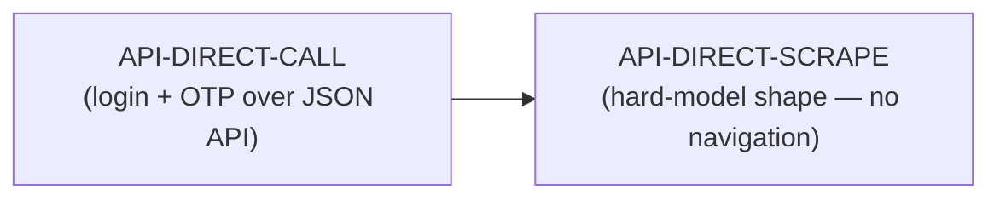

# Phases

> **Who this is for:** developers wiring a new bank, debugging a phase failure, or auditing the typed contract between phases.

Every phase implements [`BasePhase`](https://github.com/sergienko4/israeli-bank-scrapers/blob/{{BRANCH}}/src/Scrapers/Pipeline/Phases/Base/BasePhase.ts) and owns four sub-step hooks: `pre`, `action`, `post`, `final`. The `PipelineExecutor` drives them in order and threads an immutable `IPipelineContext` snapshot between phases.

## Two phases, every bank

Every registered bank runs the API-direct pipeline. No registered bank
launches a browser, so the old navigation and DOM-scrape phases
(INIT, LOGIN, OTP-TRIGGER, OTP-FILL, AUTH-DISCOVERY, ACCOUNT-RESOLVE,
DASHBOARD, SCRAPE, BALANCE-RESOLVE, TERMINATE) have been removed from
the codebase.

| Phase                                     | One-line role                                                                                                  |
| ----------------------------------------- | -------------------------------------------------------------------------------------------------------------- |
| [API-DIRECT-CALL](api-direct-call.md)     | Login + OTP over the bank's JSON API                                                                           |
| [API-DIRECT-SCRAPE](api-direct-scrape.md) | Shape-driven walk (accounts + balances + transactions) — no navigation; `.final` emits `ctx.balanceResolution` |

## What replaced the browser chain

| Removed phase                        | What API-direct does instead                                                 |
| ------------------------------------ | ---------------------------------------------------------------------------- |
| INIT                                 | No page to build — the phase holds the HTTP client and session cookies       |
| LOGIN                                | `API-DIRECT-CALL` posts the login form over HTTPS                            |
| OTP-TRIGGER / OTP-FILL               | `API-DIRECT-CALL` step list carries the OTP request and submit steps         |
| AUTH-DISCOVERY                       | The token/origin arrives in the login response, not from page traffic        |
| ACCOUNT-RESOLVE / DASHBOARD / SCRAPE | `API-DIRECT-SCRAPE` walks the bank's typed shape over REST/GraphQL           |
| BALANCE-RESOLVE                      | The shape's per-account balance extractor fills `scrape.accounts[i].balance` |
| TERMINATE                            | Nothing to close — `PipelineResult` finalises `IScraperScrapingResult`       |
