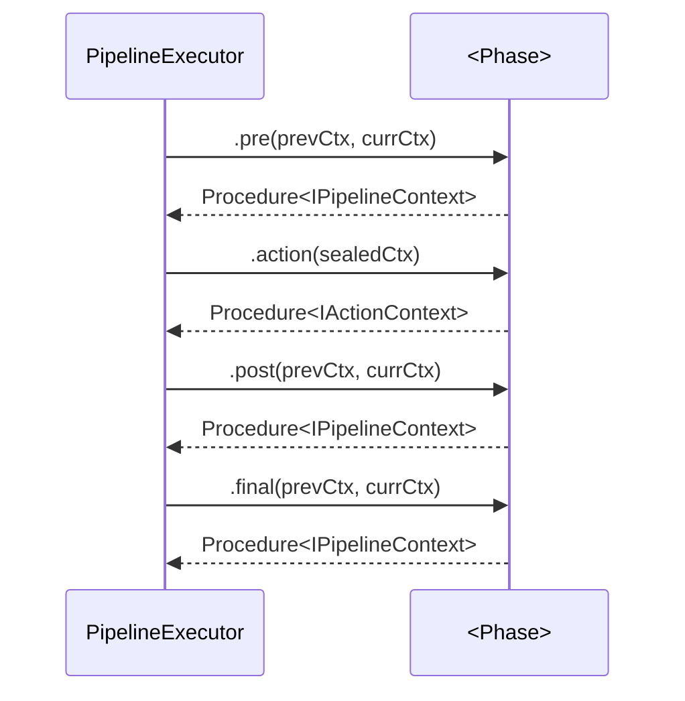

# Phases

> **Who this is for:** developers wiring a new bank, debugging a phase failure, or auditing the typed contract between phases.

Every phase implements [`BasePhase`](https://github.com/sergienko4/israeli-bank-scrapers/blob/{{BRANCH}}/src/Scrapers/Pipeline/Phases/Base/BasePhase.ts) and owns four sub-step hooks: `pre`, `action`, `post`, `final`. The `PipelineExecutor` drives them in order and threads an immutable `IPipelineContext` snapshot between phases.

## Current: API-direct banks — 2 phases

Every registered bank runs this pipeline. No registered bank launches a browser.

| Phase | Replaces (browser side) | One-line role |
|---|---|---|
| [API-DIRECT-CALL](api-direct-call.md) | INIT → LOGIN → … → OTP-FILL | Login + OTP via JSON API |
| [API-DIRECT-SCRAPE](api-direct-scrape.md) | shared — the same scrape phase the browser chain ends with | Shape-driven walk (accounts + balances + transactions) — no nav; `.final` emits `ctx.balanceResolution` |

## Retained browser infrastructure — being removed

These phases stay in the codebase until the browser-removal work completes, but **no registered bank uses them**.

| Slot | Phase | One-line role |
|---|---|---|
| 1 | [INIT](init.md) | Launch Camoufox, build context, navigate to bank URL |
| 2 | [LOGIN](login.md) | 7-strategy `SelectorResolver` + declarative `LoginConfig` |
| 3 | [OTP-TRIGGER](otp-trigger.md) | Ask bank to dispatch SMS (opt-in) |
| 4 | [OTP-FILL](otp-fill.md) | Fill the code from `otpCodeRetriever` (opt-in) |
| 5 | [AUTH-DISCOVERY](auth-discovery.md) | Capture post-login auth token + API origin |
| 6 | [API-DIRECT-SCRAPE](api-direct-scrape.md) | Shared with the API-direct pipeline above |
| 7 | [TERMINATE](terminate.md) | Close browser, finalise result |

Retired: [ACCOUNT-RESOLVE](account-resolve.md) · [DASHBOARD](dashboard.md) · [SCRAPE](scrape.md) · [BALANCE-RESOLVE](balance-resolve.md) — the generic navigation + DOM-scrape chain; still in the tree (ESLint-canary-guarded) but unused by any pipeline bank.

## Sub-step contract template

| Hook | Owns | Cannot |
|---|---|---|
| `.pre` | Read shared slots, plan the action | Modify slots outside the phase's declared scope |
| `.action` | Execute the work; sealed action-context — no mediator, no network discovery | Reach outside `IActionContext`; mutate prior slots |
| `.post` | Validate, partition, hard-fail on universal failure | Re-run the action |
| `.final` | Commit one new slot to `IPipelineContext` | Touch other phases' slots |

Failure at any sub-step returns `Procedure fail` — the executor records `errorType` + `errorMessage` and the run terminates cleanly through the rest of the chain's `.final` hooks (no half-finished state).
